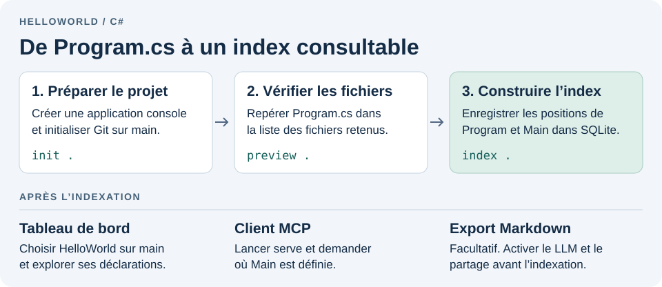
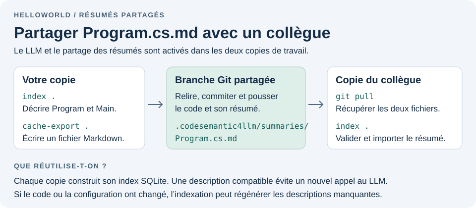

# CodeSemantic4Llm

[English](README.md) · **Français**


> **Preuve de concept expérimentale. Ce logiciel n’est pas destiné à la production.**
> Ce dépôt sert à tester une hypothèse. Certaines fonctionnalités sont incomplètes et le format de stockage comme les interfaces peuvent encore changer.

**CodeSemantic4Llm** est un serveur MCP expérimental qui indexe le code sur la machine du développeur. Un agent peut demander les quelques lignes pertinentes au lieu de charger à plusieurs reprises des fichiers entiers dans le contexte du modèle.

> État actuel : configuration YAML par dépôt, indexation des déclarations C# et des références résolues par Roslyn dans SQLite, analyse facultative Blazor/Razor (`dotnet-razor`), et requêtes MCP bornées sur les instantanés de branche. La résolution s’appuie sur une compilation légère à l’échelle du dépôt. La résolution complète des projets MSBuild reste à venir. Un LLM compatible avec l’API OpenAI peut résumer les types et méthodes C#. La recherche locale FTS5/BM25 porte sur les noms et les résumés. Les représentations vectorielles et l’analyse TypeScript sont prévues.

## Table des matières

| Section du README | Guide associé |
| --- | --- |
| [Questions de départ](#questions-de-départ) | |
| [Installer l’outil .NET](#installer-loutil-net) | [Installation et connexion des clients MCP](docs/dotnet-tool.fr.md) |
| [Premiers pas avec HelloWorld](#premiers-pas-avec-helloworld) | |
| [Architecture](#architecture) | [Architecture et stockage](docs/architecture.fr.md) |
| [Configurer chaque dépôt](#configurer-chaque-dépôt) | [Configuration YAML](docs/repository-configuration.fr.md) |
| [Compiler et tester](#compiler-et-tester) | |
| [Explorer les index dans le tableau de bord](#explorer-les-index-dans-le-tableau-de-bord) | [Tableau de bord local](docs/dashboard.fr.md) |
| [Indexer avant de lancer MCP](#indexer-avant-de-lancer-mcp) | [Indexer une copie de travail](docs/indexing.fr.md) · [Journaux MCP et dépannage](docs/logging.fr.md) |
| [Prévisualiser un dépôt depuis Rider ou un terminal](#prévisualiser-un-dépôt-depuis-rider-ou-un-terminal) | |
| [Partager les résumés du LLM](#partager-les-résumés-du-llm) | [Résumés partagés avec Git](docs/shared-summaries.fr.md) |
| [Dépendances](#dépendances) | |
| [Principes d’indexation](#principes-dindexation) | |
| [Étapes prévues](#étapes-prévues) | |

## Questions de départ

1. **Un index sémantique précis peut-il rendre de petits LLM locaux utiles sur de vrais projets ?** Leur contexte est limité. Pour naviguer dans le code ou le modifier, quelques lignes qui répondent précisément à « où ce symbole est-il déclaré ? », « qui l’appelle ? » ou « quel code concerne cette question ? » peuvent leur être plus utiles que de longs fichiers partiellement pertinents.
2. **Le même index peut-il réduire la consommation de jetons des agents payants ?** Les agents hébergés paient pour les fichiers qu’ils lisent. Des requêtes ciblées devraient permettre de mesurer une réduction du contexte et des jetons tout en conservant un accès fiable à la structure du code.

Les analyseurs, SQLite, les outils MCP et les résumés facultatifs servent à tester ces deux hypothèses. Les choix de conception restent réversibles.

## Installer l’outil .NET

Le paquet NuGet **`CodeSemantic4Llm.Mcp.Server`** est distribué via `https://nuget.pkg.github.com/rflechner/index.json`. L’exécutable **`codesemantic4llm`** propose notamment `init`, `preview`, `index`, `dashboard` et `serve`.

Consultez le [tutoriel d’installation et de configuration MCP](docs/dotnet-tool.fr.md) pour l’authentification GitHub Packages, les manifestes locaux, l’installation globale et les exemples JSON pour VS Code, GitHub Copilot CLI et Claude Desktop. Le registre exige un jeton personnel classique avec `read:packages`, même pour un paquet public. La visibilité du paquet se règle séparément de celle du dépôt.

```sh
# Une fois le flux enregistré et l’authentification configurée (voir le tutoriel) :
dotnet tool install --global CodeSemantic4Llm.Mcp.Server
codesemantic4llm --help
```

## Premiers pas avec HelloWorld



Après l’installation globale, créez un petit dépôt C# et initialisez sa configuration :

```sh
dotnet new console --name HelloWorld --use-program-main --no-restore
cd HelloWorld
git init -b main
codesemantic4llm init . --name "HelloWorld" --analyzer dotnet-csharp
```

`--use-program-main` crée une classe `Program` et une méthode `Main` explicites. `init` crée `codesemantic4llm.yaml` à la racine et refuse d’écraser un fichier existant. Aucun commit initial n’est nécessaire.

### Activer les résumés facultatifs

Par défaut, les appels au LLM sont désactivés. Vous pouvez indexer la structure du code et sa documentation XML localement. Pour générer et exporter aussi des descriptions en langage naturel, modifiez les sections existantes de `codesemantic4llm.yaml` :

```yaml
sharedSummaries: true
semanticIndexing:
  language: en
  llm:
    enabled: true
    baseUrl: http://127.0.0.1:1234/v1
    model: your-local-model
    # apiKeyEnvironmentVariable: CODESEMANTIC4LLM_LLM_API_KEY
```

Conservez `version`, `analyzers` et `tools`. Renseignez l’adresse et le modèle de votre serveur compatible avec l’API OpenAI. Si nécessaire, décommentez `apiKeyEnvironmentVariable` et définissez cette variable dans le terminal avant l’indexation. Pour des descriptions en français, utilisez `language: fr`.

Lorsque des descriptions manquent, l’indexeur envoie les déclarations de méthodes et de types au serveur choisi. Tenez-en compte dans le choix du serveur. Voir les [options du LLM et du prompt](docs/repository-configuration.fr.md#résumés-facultatifs-par-llm). Pour plusieurs machines, remplacez `baseUrl` par une liste `endpoints`, avec une clé API par serveur. Les requêtes sont parallélisées avec retries et basculement. Voir [la configuration multiserveur](docs/repository-configuration.fr.md#plusieurs-endpoints-llm-et-tolérance-aux-erreurs).

### Vérifier les fichiers sélectionnés

```sh
codesemantic4llm preview . --max-files 50
```

L’aperçu doit afficher `Program.cs`. Il vérifie la configuration et la découverte sans lire le contenu source, appeler le LLM ni écrire d’index. Les exclusions intégrées écartent notamment `bin` et `obj`. Ajoutez vos motifs sous `exclude` si nécessaire.

### Construire l’index local

```sh
codesemantic4llm index .
```

L’indexeur enregistre les emplacements de `Program` et `Main` dans le cache SQLite de la branche et génère les résumés si le LLM est activé. Les sources restent dans la copie de travail. Relancez `index` après une modification du code, de la configuration ou un changement de branche.

### Exporter les résumés

Si `sharedSummaries` et le LLM étaient activés avant l’indexation, exportez les descriptions au format Markdown :

```sh
codesemantic4llm cache-export .
```

Relisez `.codesemantic4llm/summaries/Program.cs.md` avant de le commiter avec les sources et la configuration. L’export lit l’index local sans appeler le LLM, copier les sources ni préparer de commit. Si le code ou la configuration ont changé, relancez d’abord `index`. Si les résumés sont désactivés, passez cette étape. Suivez [le parcours de Program.cs.md dans Git](#partager-les-résumés-du-llm) ou consultez le [guide du partage](docs/shared-summaries.fr.md).

### Explorer le tableau de bord

```sh
codesemantic4llm dashboard --port 5080
```

Ouvrez [le tableau de bord](http://127.0.0.1:5080/), sélectionnez HelloWorld et sa branche `main`, puis examinez `Program`, `Main` et leurs éventuels résumés. La consultation du cache local se fait en lecture seule. Arrêtez le serveur avec Ctrl+C avant de réutiliser le terminal, ou laissez-le dans un terminal séparé. [Guide du tableau de bord](docs/dashboard.fr.md)

### Connecter un client MCP

Depuis la racine du dépôt HelloWorld :

```sh
codesemantic4llm serve .
```

`serve` attend un client MCP sur stdio, en lecture seule. Arrêtez cette exécution manuelle avec Ctrl+C avant de confier le lancement au client.

Dans **VS Code / GitHub Copilot Chat**, ouvrez le dossier `HelloWorld` et créez `HelloWorld/.vscode/mcp.json` :

```json
{
  "servers": {
    "helloWorld": {
      "type": "stdio",
      "command": "codesemantic4llm",
      "args": ["serve", "${workspaceFolder}"]
    }
  }
}
```

`${workspaceFolder}` désigne le dépôt ouvert. Démarrez le serveur depuis la configuration MCP et acceptez la demande de confiance. VS Code gère le processus `serve`. Si l’exécutable global est absent du `PATH` de VS Code, renseignez son chemin absolu dans `command`. Pour un outil local, GitHub Copilot CLI ou Claude Desktop, consultez les [autres exemples](docs/dotnet-tool.fr.md#4-configurer-un-client-mcp).

Demandez ensuite à l’agent où est définie `Main` dans HelloWorld. Il devrait utiliser `find_symbols` pour obtenir son emplacement. Le serveur lit l’index enregistré. Après une modification, relancez `index` ou laissez `codesemantic4llm watch .` actif dans un autre terminal. La surveillance attend `watch.debounceSeconds` secondes après la dernière édition (15 par défaut) et conserve l'ancien index si Roslyn détecte une erreur de syntaxe ; voir [l'indexation continue](docs/indexing.fr.md#réindexation-continue-et-sécurisée-avec-watch).

## Architecture

| Projet | Responsabilité |
| --- | --- |
| `CodeSemantic4Llm.Domain` | Identité du dépôt et de la branche, configuration, emplacements et symboles communs |
| `CodeSemantic4Llm.Application` | Cas d’utilisation et contrats d’analyse, de configuration, de découverte et de stockage |
| `CodeSemantic4Llm.Analysis.CSharp` | Extraction des déclarations C# avec Roslyn |
| `CodeSemantic4Llm.Analysis.TypeScript` | Adaptateur prévu pour Tree-sitter et TypeScript/Angular |
| `CodeSemantic4Llm.Configuration.Yaml` | Création, lecture et validation de la configuration à la racine |
| `CodeSemantic4Llm.Persistence.Sqlite` | Instantanés versionnés, publication atomique et requêtes bornées |
| `CodeSemantic4Llm.Infrastructure.Workspace` | Git, accès sécurisé au système de fichiers et motifs d’exclusion |
| `CodeSemantic4Llm.Mcp.Server` | Assemblage des dépendances, transport stdio et outils MCP |

Consultez les [choix d’architecture](docs/architecture.fr.md), le [contrat YAML](docs/repository-configuration.fr.md) et le [guide de l’indexation](docs/indexing.fr.md). Le [schéma de stockage prévu](docs/architecture.fr.md#stockage-prévu) représente les YAML, les instantanés de branche et les caches partagés sans copie des fichiers source.

## Configurer chaque dépôt

Créez `codesemantic4llm.yaml` à la racine de **chaque dépôt** :

```shell
dotnet run --project src/CodeSemantic4Llm.Mcp.Server -- \
  init /absolute-or-relative/path/to/repository --name "My Project" --analyzer dotnet-csharp --lang fr
```

Le répertoire doit exister. Les chemins relatifs partent du répertoire courant du processus. Mettez entre guillemets ceux contenant des espaces. `--lang` vaut `en` par défaut et accepte aussi la forme `--lang=fr`. Les options peuvent précéder ou suivre le chemin. Répétez `--analyzer <id>` pour sélectionner plusieurs analyseurs. Par défaut, `dotnet-csharp` est sélectionné. Les identifiants sont nettoyés, convertis en minuscules et dédupliqués dans leur ordre d’apparition. Tous doivent être disponibles. Seul `dotnet-csharp` l’est actuellement.

`--name "My Project"` écrit le libellé facultatif `projectName`. Il conserve la casse, les espaces internes et les caractères Unicode ; les espaces de début et de fin sont supprimés. Sans cette option, le projet reste sans nom. Son identité dans le cache est indépendante du libellé. `init` conserve les extensions par défaut, ne crée aucune exclusion personnalisée et énumère tous les outils sous `tools`. Commentez ceux à masquer. Une configuration existante provoque une erreur sans être écrasée. Consultez `init --help`. Dans Rider, passez `init /path/to/repository --lang fr` à `CodeSemantic4Llm.Mcp.Server`.

Vous pouvez aussi modifier le YAML à la main :

```yaml
version: 1
projectName: My Project   # Libellé facultatif
analyzers:
  - dotnet-csharp
# Facultatif : remplace les extensions par défaut de cet analyseur (.cs).
# fileExtensions:
#   dotnet-csharp: [.cs, .csharp]
# Outils MCP annoncés pour ce dépôt. init écrit tous les noms.
# Commentez une ligne pour masquer l’outil. Omettez la section pour tous les annoncer.
tools:
  - get_server_info
  - find_symbols
  # - replace_method_body
  # ... liste complète dans docs/repository-configuration.fr.md
semanticIndexing:
  language: en   # Facultatif : utilisez fr, fr-CH, etc.
  llm:
    enabled: false  # Activer explicitement pour ce dépôt
    # baseUrl: http://127.0.0.1:1234/v1
    # model: my-local-model
    # apiKey: your-api-key
    # apiKeyEnvironmentVariable: CODESEMANTIC4LLM_LLM_API_KEY
exclude: []
```

Les motifs `**/.git/**`, `**/bin/**` et `**/obj/**` sont toujours exclus. Les sous-modules sont inclus sauf exclusion explicite. La découverte parcourt récursivement le dépôt, ignore les liens symboliques et sélectionne les fichiers `.cs` sans tenir compte de la casse. `fileExtensions` remplace la liste d’extensions d’un analyseur activé : conservez `.cs` dans la liste si vous souhaitez l’indexer. L’aperçu affiche les extensions effectives et jusqu’à 200 chemins candidats, sans lire leur contenu.

`semanticIndexing.language` sélectionne la langue des descriptions générées (anglais par défaut), indépendamment du langage source. Pour activer le LLM, définissez `semanticIndexing.llm.enabled: true`, `baseUrl` et `model`. Les commentaires XML C# `<summary>` sont indexés localement même si les appels sont désactivés. Par défaut, seules les déclarations sans résumé exploitable sont envoyées au modèle. Avec `forceGeneration: true`, la génération peut remplacer un résumé existant. Une valeur `apiKey` non vide a priorité sur `apiKeyEnvironmentVariable` pour le jeton Bearer. Les réponses MCP de configuration omettent la clé.

`semanticIndexing.llm.systemPrompt` personnalise les consignes et `{lang}` y insère la langue configurée. `init` fournit le modèle par défaut en commentaire. [Personnalisation du prompt](docs/repository-configuration.fr.md#personnaliser-le-prompt-système)

Le serveur LLM reçoit **la méthode ou le type C# entier**, documentation XML comprise. Le résumé, limité à dix lignes, est disponible via MCP et le tableau de bord. SQLite ne copie pas les sources. [Configuration du LLM](docs/repository-configuration.fr.md#résumés-facultatifs-par-llm). L’analyseur TypeScript est prévu mais pas encore enregistré.

## Compiler et tester

Installez le SDK .NET 10 et Git pour les opérations sur les dépôts :

```shell
dotnet restore CodeSemantic4Llm.slnx
dotnet build CodeSemantic4Llm.slnx
dotnet test CodeSemantic4Llm.slnx
```

Les tests fonctionnels associent **Reqnroll** (successeur de SpecFlow) à xUnit v3. Les fichiers `.feature` décrivent le comportement attendu sous forme de spécifications exécutables.

## Explorer les index dans le tableau de bord

Lancez l’explorateur HTTP local en lecture seule pour consulter dépôts, branches, déclarations, fichiers, catégories et références résolues :

```shell
dotnet run --project src/CodeSemantic4Llm.Mcp.Server -- dashboard --port 5080
```

Ouvrez **http://127.0.0.1:5080/**. L’interface fonctionne hors ligne, sans lire les sources, démarrer MCP ni relancer l’indexation. Lancez `index` sur la branche à consulter. Chaque fichier terminé et ses symboles apparaissent au fil de l’indexation et restent consultables si vous l’interrompez. Le tableau de bord utilise le même `CODESEMANTIC4LLM_INDEX_ROOT` que MCP. [Fonctions et API JSON](docs/dashboard.fr.md)

## Indexer avant de lancer MCP

Après la création du YAML, indexez tous les fichiers sélectionnés :

```shell
dotnet run --project src/CodeSemantic4Llm.Mcp.Server -- \
  index /absolute-or-relative/path/to/repository
```

Le chemin doit désigner la racine d’une copie Git sur une branche nommée. Le terminal interactif affiche la progression Spectre pour la découverte, l’analyse, la vérification et la publication. Une sortie redirigée donne un bilan en texte simple. Le nombre de fichiers indexés est illimité.

Après une interruption, relancez `index .` pour réutiliser les fichiers déjà analysés sur la même branche. Utilisez `index . --force` pour réanalyser tous les fichiers sélectionnés.
Pour indexer progressivement un gros dépôt, lancez `index . --folder src/Navigation`
puis `index . --folder src/Search`. Chaque exécution réussie **complète ou met
à jour l'instantané publié de la branche**, sans réanalyser les autres dossiers.
MCP `search_code` et `find_symbols` interrogent immédiatement l'ensemble
cumulé ; le tableau de bord l'indique comme partiel. Utilisez `index .` sans
`--folder` seulement pour couvrir tout le dépôt ou recalculer les références
Roslyn entre dossiers.

Une nouvelle indexation réutilise les déclarations inchangées et retire les entrées supprimées ou renommées. Chaque branche conserve son instantané publié. Les entrées FTS5 suivent la même publication atomique. Un échec ou une annulation préserve l’instantané précédent. SQLite conserve uniquement les métadonnées dérivées, hors du dépôt. Pour remplacer `LocalApplicationData/CodeSemantic4Llm/indexes`, définissez `CODESEMANTIC4LLM_INDEX_ROOT` sur un chemin absolu et réutilisez-le pour MCP.

Démarrez le serveur pour la copie de travail choisie :

```shell
dotnet run --project src/CodeSemantic4Llm.Mcp.Server -- \
  serve /absolute-or-relative/path/to/repository
```

`serve [repository-path]` accepte un répertoire existant. L’argument prévaut sur `CODESEMANTIC4LLM_REPOSITORY_ROOT`. Sans argument, la sélection par variable d’environnement reste active. Les chemins relatifs partent du répertoire courant du processus. Dans Rider, utilisez `serve /path/to/repository`. Le démarrage n’indexe pas le projet.

Chaque description d’outil nomme le projet, par exemple `In project TinyHarness, ...`. Définissez `projectName: TinyHarness` ou laissez le serveur utiliser le nom du répertoire. Rafraîchissez la liste des outils après un changement de nom.

MCP utilise **stdio** et envoie les journaux sur **stderr**. `--log-file /absolute/path/to/codesemantic4llm.jsonl` conserve les paramètres et réponses complets, extraits source compris. [Journaux et dépannage](docs/logging.fr.md)

Par défaut, les outils disponibles incluent `get_server_info`, `find_symbols`, `search_code`, `get_type_members`, `find_usages`, `get_method`, `get_method_body`, `validate_method_body` et les diagnostics de fichiers, types et méthodes. Commentez un nom dans `tools` pour le masquer et refuser les appels. Supprimer la section autorise la liste complète dans les limites des options du serveur : un outil d’écriture exige toujours `--allow-write`. [Sélection des outils](docs/repository-configuration.fr.md#sélectionner-les-outils-mcp)

Les outils de code masquent les détails d’indexation, les empreintes de fichier et les identifiants d’instantané. Indiquez `relativePath` et `name` (simple ou qualifié), puis `line` et `column` de l’identificateur si plusieurs déclarations correspondent. Aucune recherche préalable ni identifiant temporaire de symbole n’est requis. `CliApplication.RunAsync` correspond à `TinyHarness.Cli.CliApplication.RunAsync` si le résultat est unique dans le fichier. La casse et les segments entiers séparés par des points comptent.

Les réponses JSON conservent les accents et la ponctuation du code. Les guillemets suivent l’échappement JSON habituel, les caractères `+`, `<`, `>` et les apostrophes restent littéraux. Les séquences d’échappement déjà présentes dans les sources restent intactes. Le client doit analyser le JSON.

`find_symbols` cherche un nom simple exact et sensible à la casse (20 résultats par défaut, 200 au maximum). `search_code` classe une question en langage naturel avec SQLite FTS5/BM25 sur les noms, la documentation et les résumés enregistrés. Il renvoie les emplacements et les descriptions disponibles. La recherche par mots-clés fonctionne sans serveur LLM et sans représentations vectorielles. [Recherche FTS5](docs/indexing.fr.md#rechercher-avec-fts5)

Lorsqu'une recherche renvoie un type (classe, interface, structure, record, énumération ou délégué),
la réponse contient également `typeUsages`. Chaque entrée relie la déclaration par son
`typeLocation` à **cinq références résolues au maximum** dans `usages`, avec `hasMore`
pour signaler d'autres utilisations. `isAvailable: true` et une liste vide signifient
qu'aucune référence n'est indexée. `isAvailable: false` signifie au contraire que
les références n'ont pas été calculées (indexation partielle par dossiers ou ancien cache).
Une recherche limitée aux méthodes conserve la structure `symbols` / `hasMore`.
Ces aperçus réutilisent SQLite sans réanalyser les sources ni appeler un LLM.

Pour lister les méthodes d’une classe, utilisez `get_type_members` avec son fichier,
son nom et `kind: "method"`. Pour récupérer les références supplémentaires ou les
appelants d'une méthode, utilisez `find_usages` avec la même adresse source. Ces deux
outils paginent à 50 résultats par défaut et 200 au maximum. Les surcharges restent
distinctes, les déclarations partielles se sélectionnent séparément et les membres
hérités sont exclus. Les références non résolues et les graphes de dépendances des
projets ne sont pas évalués.

La personne qui exploite le serveur doit relancer `index` après modification. Ni le démarrage MCP ni les requêtes ne reconstruisent l’index. Pour ajouter `get_repository_configuration`, `preview_repository_index` et `get_repository_index_status` :

```shell
dotnet run --project src/CodeSemantic4Llm.Mcp.Server -- \
  serve /path/to/repository --expose-indexing
```

`--expose-indexing` peut se combiner avec `--allow-write` et ne donne aucun droit d’écriture. Les arguments et résultats des outils de code sont identiques dans les deux modes. Seul l’état de l’index expose les métadonnées de l’instantané. Redémarrez le serveur et actualisez la liste des outils après un changement de mode. [Interface MCP](docs/indexing.fr.md#interroger-lindex-via-mcp)

Pour mettre à niveau un ancien cache, relancez `index` sur chaque branche à interroger. Le schéma 3 ajoute les références, le 4 les résumés facultatifs et le 5 l’index FTS5. Les déclarations existantes restent lisibles avant réindexation. Redémarrez MCP pour que les clients découvrent `find_usages` et `search_code`.

### Modifier le code d’une méthode

Le serveur est **en lecture seule par défaut**. Pour autoriser la modification de méthodes C# :

```shell
dotnet run --project src/CodeSemantic4Llm.Mcp.Server -- \
  serve /path/to/repository --allow-write
```

`get_method_body` lit le corps courant sur disque même sans index ni recherche préalable (12 000 caractères par page par défaut). Le serveur suit la version du fichier. Transmettez chaque `nextOffset` tel quel. `replace_method_body` exige `--allow-write` et accepte le chemin, le nom et un corps avec ou sans accolades : `return 42;` et `{ return 42; }` sont valides. L’outil ajuste l’indentation au contexte, préserve l’indentation relative et les espaces des chaînes multilignes, et suit les fins de ligne du fichier. Seul le corps exécutable est remplacé.

**Aucune lecture préalable n’est obligatoire.** `get_method` et `get_method_body` servent à l’inspection. `replace_method` remplace la déclaration entière, attributs, signature et corps compris, à partir de son chemin et de son nom actuels. Les deux outils fonctionnent sans données de navigation, après redémarrage et avec `--expose-indexing`. Le client ne gère aucune version.

Appelez directement l’outil d’écriture souhaité. Les deux valident la syntaxe avant d’écrire. En cas d’erreur, le fichier reste intact et la réponse MCP contient jusqu’à dix diagnostics C#, leurs identifiants, messages et positions dans le fichier proposé, ainsi que le nombre d’erreurs restantes. Corrigez puis réessayez le même outil. Une chaîne non terminée peut ainsi donner `CS1010: Newline in constant`. Les réponses de succès restent compactes.

`validate_method_body` permet une validation paginée sans tentative d’écriture, même en lecture seule. `get_method_diagnostics` lit la méthode actuelle, y compris avant réindexation : indiquez chemin, ligne, colonne et nom attendu. Les diagnostics bornés comprennent les identifiants C# et les positions.

`get_file_diagnostics` accepte simplement `{"relativePath":"src/Worker.cs"}`, même si la syntaxe empêche de sélectionner une méthode. `get_type_diagnostics` prend `relativePath`, `line`, `column` et `expectedTypeName` et inclut les membres et les types imbriqués de la déclaration. Ces deux outils respectent l’analyseur et les extensions configurés et renvoient 50 diagnostics par défaut, 200 au maximum. Passez `nextOffset` comme `offset` pour continuer. Une modification du fichier invalide la suite. Redémarrez MCP et rafraîchissez la liste des outils si nécessaire.

**Ces diagnostics portent sur la syntaxe. Ils ne compilent pas le projet et ne vérifient pas les types.**

L’écriture cible le fichier présent au moment de l’appel. Elle refuse les changements de branche, de révision ou de fichier survenus pendant l’opération, les erreurs de syntaxe et le remplacement du corps d’une méthode qui en est dépourvue. Les changements antérieurs font partie du fichier courant et ne sont pas comparés à une ancienne lecture du modèle. Les écritures sont limitées aux sources UTF-8 du dépôt sélectionné et refusent les liens symboliques ou les remontées de répertoire. **Relancez `index` après l’écriture** et vérifiez le diff Git avant de commiter. [Procédure d’édition](docs/indexing.fr.md#lire-et-remplacer-le-corps-dune-méthode)

### Configurer un client MCP avec une compilation locale

Pour l’outil .NET installé, consultez les [exemples de configuration](docs/dotnet-tool.fr.md#4-configurer-un-client-mcp). Pour une DLL compilée depuis les sources, définissez un serveur stdio dans `.vscode/mcp.json` avec le dépôt dans `args` :

```json
{
  "servers": {
    "codeSemantic4Llm": {
      "type": "stdio",
      "command": "dotnet",
      "args": [
        "/absolute/path/to/CodeSemantic4Llm/src/CodeSemantic4Llm.Mcp.Server/bin/Debug/net10.0/CodeSemantic4Llm.Mcp.Server.dll",
        "serve",
        "${workspaceFolder}"
      ]
    }
  }
}
```

Compilez d’abord le serveur puis adaptez le chemin vers la DLL. Lancer la DLL évite de mélanger les messages de compilation au flux MCP. `${workspaceFolder}` désigne l’espace de travail ouvert ; un chemin absolu convient aussi. D’autres clients emploient une structure JSON différente mais les mêmes arguments de processus. Si vous utilisez `CODESEMANTIC4LLM_INDEX_ROOT`, transmettez aussi cette variable au serveur lancé par le client. [Configuration MCP de VS Code](https://code.visualstudio.com/docs/agents/reference/mcp-configuration)

## Prévisualiser un dépôt depuis Rider ou un terminal

Pour afficher les fichiers découverts, passez le chemin d’un dépôt contenant `codesemantic4llm.yaml` :

```shell
dotnet run --project src/CodeSemantic4Llm.Mcp.Server -- \
  preview /absolute/path/to/repository --max-files 200
```

Dans Rider, ouvrez **Run > Edit Configurations**, créez une configuration **.NET Project**, sélectionnez `CodeSemantic4Llm.Mcp.Server` et indiquez `preview /absolute/path/to/repository --max-files 200` dans **Program arguments**. Lancez ou déboguez la configuration. Un point d’arrêt dans `FileSystemRepositoryFileEnumerator.EnumerateFiles` permet d’observer le parcours. [Documentation Rider](https://www.jetbrains.com/help/rider/Run_Debug_Configuration_dotNet_Project.html)

L’aperçu suit les règles de MCP, affiche ses résultats puis se termine. La limite par défaut est de 50 fichiers (maximum 200) et la sortie signale les fichiers supplémentaires. Il ne lit pas le contenu source, n’exécute pas le projet et ne persiste aucun index. Sans commande, le programme attend les requêtes MCP. `--help` liste `init`, `preview`, `index`, `watch`, `cache-export`, `setup-git`, `git-merge-summary`, `dashboard` et `serve`. `serve` démarre le même serveur que l’invocation sans arguments et permet de sélectionner le dépôt.

Spectre.Console.Cli traite les arguments et génère l’aide. Spectre.Console affiche les résultats et l’aide sur stdout, les erreurs sur stderr. Une commande ou une option inconnue échoue sans démarrer MCP.

## Partager les résumés du LLM



`sharedSummaries: true` active la réutilisation des descriptions versionnées dans `.codesemantic4llm/summaries/**/*.md`. `index` vérifie les identités de la source, du modèle, du prompt, de la langue et de l’analyseur avant l’import local dans SQLite/FTS5. `cache-export` publie les descriptions pour relecture et `watch` vérifie le dépôt au démarrage puis après les changements. La préparation des fichiers et les commits Git restent manuels. [Format, partage et résolution des conflits](docs/shared-summaries.fr.md)

## Dépendances

Les paquets NuGet utilisent **Central Package Management**. Les versions figurent exclusivement dans `Directory.Packages.props`. Les entrées `PackageReference` omettent `Version`. `Directory.Build.props` contient les réglages communs de compilation et `global.json` configure le SDK .NET et Microsoft Testing Platform.

## Principes d’indexation

- La copie de travail Git d’origine fait foi. Ne dupliquez aucun arbre source.
- Isolez les index par dépôt et branche. Validez les noms de branches avant tout usage comme répertoires.
- Persistez les métadonnées dérivées, les identités de symboles, emplacements, empreintes et relations. Les sources restent dans le dépôt.
- Mutualisez les concepts de requête communs aux langages tout en autorisant des entités et des tables spécifiques.
- Préférez les mises à jour incrémentales, les résultats déterministes et les réponses MCP compactes.
- Gardez compilateur et SQLite hors des couches domaine et application.

## Étapes prévues

1. Compiler avec la connaissance des projets et stabiliser l’identité des symboles entre projets.
2. Implémenter l’analyse TypeScript/Angular avec une intégration Tree-sitter validée.
3. Ajouter des extraits source vérifiés par empreinte et une navigation paginée.
4. Tenir compte des dépendances pour l’invalidation et la réutilisation entre branches.
5. Introduire la recherche vectorielle et invalider les résumés plus finement, indépendamment de l’extraction des déclarations.

Lisez les [consignes du dépôt](AGENTS.fr.md) avant toute modification.
