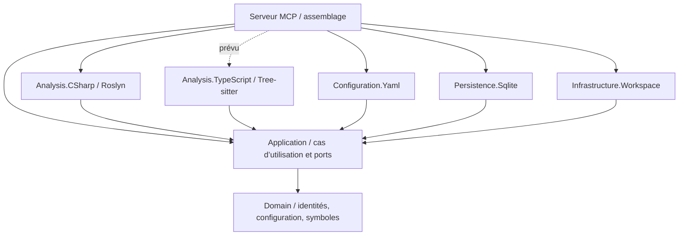
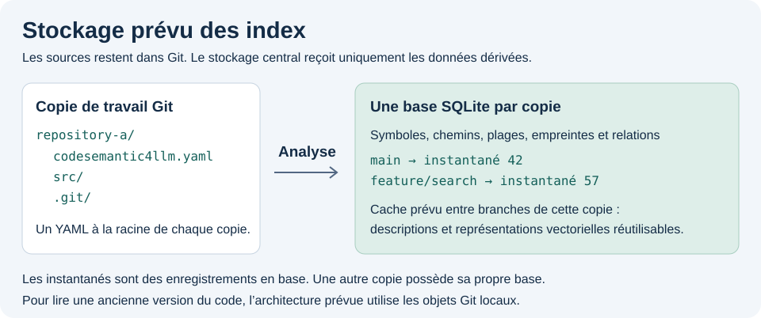

# Architecture

[English](architecture.md) · **Français**

Le [cache facultatif de résumés partagés](shared-summaries.fr.md) distribue du Markdown dérivé via Git. Les instantanés SQLite/FTS5 restent locaux à chaque branche. L’import, l’export, la surveillance et la résolution des conflits suivent les mêmes frontières de dépendances.

## Sens des dépendances

Le domaine ne dépend ni de Git, ni de Roslyn, Tree-sitter, YAML, SQLite ou MCP. L’application définit les ports. Les adaptateurs dépendent des couches internes. Seul l’exécutable MCP assemble les dépendances.

## Commandes console et transport MCP

`Program.cs` relie injection de dépendances, flux de sortie et annulation. Spectre.Console.Cli distribue `init`, `preview`, `index`, `dashboard` et `serve` à des commandes distinctes dotées de paramètres déclaratifs. La commande par défaut lance le même serveur MCP stdio que `serve`. Un petit registre relie Spectre à l’injection de dépendances Microsoft et libère le fournisseur de services de chaque exécution. Les cas d’utilisation et adaptateurs ignorent Spectre.

`serve [repository-path]` délègue à la même composition d’hôte que la commande par défaut sans argument. Ainsi un nom de commande inconnu reste une erreur. Un chemin fourni doit désigner un répertoire existant. Il est normalisé relativement au répertoire courant. L’hôte en fait la dernière surcharge de configuration, prioritaire sur l’environnement, sans modifier les variables du processus. Stdout reste réservé au protocole MCP.

Spectre génère l’aide et analyse les arguments typés, y compris les sélections répétées d’analyseurs. Les occurrences de l’option de langue sont comptées pour refuser les doublons. Un intercepteur commun refuse les arguments non liés avant l’exécution. Il évite ainsi que Spectre.Console.Cli 0.57.2 interprète son jeton interne de commande par défaut comme une valeur d’option manquante lors d’une [seconde analyse stricte](https://github.com/spectreconsole/spectre.console.cli/blob/9c88a343b8ce622e9fda4e4334b2057d773d90c9/src/Spectre.Console.Cli/Internal/CommandExecutor.cs#L165). L’application ne découpe pas manuellement les arguments.

Résultats et aide vont sur stdout, erreurs sur stderr. Les chemins dynamiques et diagnostics s’affichent en texte simple, sans interprétation comme balisage Spectre. MCP réserve stdout au protocole et envoie les journaux sur stderr. Les tests fonctionnels utilisent le vrai parseur CLI et vérifient la réponse d’initialisation MCP de l’exécutable.

## Configuration locale au dépôt

Chaque dépôt possède `codesemantic4llm.yaml` à sa racine. L’adaptateur YAML le lit et le valide. Le cas d’utilisation résout les analyseurs demandés. L’adaptateur de l’espace de travail parcourt récursivement le dépôt avec les exclusions glob effectives. L’aperçu renvoie un nombre borné de chemins ; l’indexation traite tous les fichiers sélectionnés. Les deux partagent la résolution des analyseurs et des extensions dans l’application.

`init` crée la configuration par défaut via un cas d’utilisation. L’application vérifie les analyseurs choisis et sélectionne C# en l’absence de choix. Le domaine normalise les identifiants et valide la langue des descriptions. Des options répétées remplacent le défaut et conservent leur ordre de priorité. `Configuration.Yaml` sérialise dans un fichier temporaire du répertoire choisi, puis le déplace à sa destination sans écraser un fichier existant. Échec ou annulation ne laissent pas de YAML partiel. Cette écriture appartient à la CLI locale. L’aperçu MCP reste en lecture seule.

Chaque adaptateur de langage possède ses extensions par défaut (`.cs` pour C#). Le domaine représente les sélections d’extensions validées et immuables. L’adaptateur YAML mappe les surcharges par analyseur. L’application vérifie la disponibilité, applique les surcharges et sélectionne les chemins. Une surcharge remplace la liste de cet analyseur sans changer son parseur ni contourner les exclusions. Le parcours générique du système de fichiers reste indépendant du langage et aucun registre central d’extensions n’est nécessaire.

L’identifiant d’analyseur `dotnet-csharp` se distingue du langage `csharp`. Un analyseur non pris en charge provoque une erreur explicite. Le serveur lit uniquement le dépôt choisi par l’argument de `serve` ou, à défaut, `CODESEMANTIC4LLM_REPOSITORY_ROOT`. Un appel MCP ne peut pas fournir une racine arbitraire.

`projectName`, modifiable dans le YAML ou par `init --name`, est un libellé facultatif. Le domaine le valide et supprime les espaces aux extrémités. Le YAML gère la sérialisation. Les réponses de configuration et d’aperçu l’affichent sans remplacer l’identité dépôt/branche. Le libellé ne participe ni à l’empreinte d’analyse ni aux chemins de stockage. Le renommer permet de réutiliser les déclarations sans changer le schéma SQLite. [Contrat YAML](repository-configuration.fr.md)

## Frontières de l’index

Une copie de travail et une branche identifient ensemble un index. À chemins identiques, deux branches peuvent avoir des structures différentes.

- Le dépôt d’origine fait foi. L’index ne contient **aucune copie de fichier source**.
- Séparez les identités et emplacements du moteur de stockage.
- Gardez une projection commune minimale pour les requêtes et autorisez des tables distinctes pour C#, TypeScript, F# et les autres langages.
- Lisez et validez la branche Git actuelle sans présumer qu’il s’agit de `main`.
- Indexez le contenu sur disque avec ses empreintes et le HEAD observé. Cela ne garantit pas une copie de travail propre.
- Retirez les données supprimées ou renommées lors du remplacement de l’instantané. Refusez les changements de branche détectés en cours d’exécution.
- Gardez le schéma SQLite versionné et reconstructible. Le schéma initial de déclarations laisse évoluer le futur modèle propre à chaque langage.

## Instantanés de déclarations implémentés

`IndexRepository` coordonne état Git, configuration, découverte, lecture, analyse, vérification et publication via les ports de l’application. `IIndexUpdate` possède une génération non publiée ; sa libération sans publication conserve les fichiers terminés pour le tableau de bord. `ISourceAnalyzer.IndexVersion` invalide les résultats réutilisés quand l’adaptateur compilé change. Un adaptateur C# extrait la syntaxe fichier par fichier. Un second construit une compilation transitoire du dépôt et utilise Roslyn SemanticModel pour relier les références explicites aux méthodes et types. Il ne charge pas le graphe MSBuild. Frontières de projets, compilation conditionnelle et assemblies NuGet externes nécessiteront le contexte de compilation des projets. Les usages ambigus ou non résolus sont omis.

Pour chaque membre, Roslyn enregistre l’emplacement de la déclaration du type contenant immédiat. Cette arête distingue types imbriqués, homonymes et génériques même si leurs noms affichés coïncident. Les requêtes utilisent l’emplacement exact dans l’instantané attendu. Les parties d’une déclaration partielle sont distinctes, puisque la syntaxe seule n’établit pas leur identité de compilation. Les membres hérités sont hors de ce contrat.

L’adaptateur SQLite associe la racine canonique du dépôt à un répertoire SHA-256 sous le cache central configurable. Une base contient un instantané achevé par branche nommée. Identifiants et noms de branches sont des données de la base, jamais des chemins construits à partir d’une branche. Les sources sont lues sur place, un fichier à la fois, sans insertion dans SQLite. La passe de déclarations croît avec les chemins et métadonnées. La passe de références garde en mémoire les arbres syntaxiques C# jusqu’à la fin de la résolution, ce qui augmente le pic mémoire sur les grands dépôts.

Chaque fichier terminé est enregistré dans l’instantané partiel pour que le tableau de bord puisse le lire pendant l’indexation. Dans la même branche, les lignes dérivées sont réutilisées si empreintes, versions d’adaptateur et configuration concordent. L’indexeur analyse les fichiers nouveaux ou modifiés et omet les chemins disparus. La publication change le pointeur de branche et supprime l’ancienne génération dans la même transaction. Le mode WAL permet aux lecteurs de consulter l’instantané complet précédent pendant l’écriture. Chaque lecture utilise une transaction pour garder métadonnées et déclarations cohérentes.

Le schéma 2 a ajouté les coordonnées du contenant et l’appartenance au type. Le schéma 3 ajoute `symbol_references`, indexée par instantané et emplacement cible. Les références comportent uniquement chemin, ligne et colonne de l’usage. Un marqueur empêche un ancien instantané de conclure à tort qu’il n’existe aucun usage. Les caches des versions 1 à 4 sont mis à niveau lors d’une écriture ; les lectures encore prises en charge restent disponibles. Une publication échouée conserve les anciennes déclarations. Les références absentes demandent une réindexation. Les requêtes paginées ont un ordre déterministe et vérifient l’identifiant d’instantané.

Les opérations SQLite sont synchrones car Microsoft.Data.Sqlite exécute les opérations ADO asynchrones de manière synchrone. L’annulation est vérifiée entre fichiers, déclarations et instructions et avant le commit. Les lectures, Git et les analyseurs acceptent l’annulation. La CLI transmet la progression à Spectre et ne signale la fin qu’après le commit.

Avant publication, l’indexeur recalcule les empreintes, redécouvre les chemins et relit Git et la configuration. Une différence annule l’opération. Cette vérification ne constitue pas un instantané atomique du système de fichiers : une édition peut encore suivre le dernier contrôle. Les requêtes vérifient le HEAD et montrent les métadonnées enregistrées sans scanner les fichiers pour prouver leur fraîcheur. [Comportement et limites](indexing.fr.md)

## Diagnostics syntaxiques Roslyn sur une méthode

`IMethodSyntaxDiagnostics` définit le port de diagnostic syntaxique. L’adaptateur C# analyse la méthode sélectionnée ou un remplacement de corps proposé en mémoire. Les diagnostics contiennent les identifiants, messages et positions physiques à partir de 1 dans le fichier d’origine ou proposé. SQLite ne conserve ni source ni texte de diagnostic. Éditeur et validateur normalisent le corps de la même manière. Ils acceptent un bloc explicite ou ses instructions internes. Un bloc initial est traité comme explicite ; sinon deux accolades sont ajoutées avec les fins de ligne du fichier, en séparant les commentaires de fin de ligne de l’accolade fermante. Accolades déséquilibrées et flux de contrôle mal formé sont refusés. Les positions concernent le fichier proposé normalisé. Hors de la plage du corps initial, le texte demeure identique.

`validate_method_body` vérifie en lecture seule le chemin et le nom sur disque sans lecture préalable ni version fournie par le client. Le cas d’édition effectue le même contrôle sur la source qu’il va modifier. `MethodEditValidationException` transporte les erreurs à MCP, qui renvoie une réponse bornée avec identifiants, messages et positions proposées. Une écriture évite donc un aller-retour de validation et un second envoi du corps. Le succès renvoie un emplacement compact. Le validateur autonome reste utilisable sans écriture.

L’éditeur de déclaration complète utilise la même exception. Pendant l’ajustement d’indentation, il conserve l’arbre de méthode récupéré par Roslyn et projette les erreurs de la déclaration détachée sur les positions physiques du fichier proposé. Une signature invalide ou une chaîne non terminée reçoit ainsi un diagnostic précis. Une forme invalide reçoit aussi `CS4L0002`. MCP renvoie dix diagnostics au maximum avec le nombre restant et invite à réessayer le même outil. Aucune compilation ni exécution du projet. Pour `CS1012`, le message rappelle que C# entoure les chaînes de guillemets doubles et les caractères de guillemets simples. Cet indice ne transforme aucun littéral et n’est ajouté ni aux succès ni aux autres erreurs.

`get_method_diagnostics` lit directement le dépôt choisi et vérifie le nom et la position exacte de l’identificateur. Il fonctionne sans instantané à jour, notamment après une édition. Les deux outils paginent les diagnostics quel que soit `--allow-write`. `isValid` signifie uniquement **syntaxiquement valide**. Noms absents, retours incompatibles et avertissements sémantiques nécessitent une future compilation Roslyn connaissant les projets. Aucun outil de build ni code du projet n’est exécuté.

## Édition des sources sur autorisation explicite

`serve --allow-write` fixe une capacité `RepositoryWriteAccess` immuable pour le processus. Ni YAML, ni configuration d’environnement, ni paramètres MCP ne l’accordent. En lecture seule, l’hôte enregistre `get_method_body` et omet `replace_method_body`. L’enregistrement explicite remplace la découverte automatique de tout l’assembly. Le cas d’utilisation vérifie aussi l’autorisation.

`CurrentMethodOperations` recherche la méthode actuelle par chemin et nom, éventuellement position de l’identificateur pour les surcharges. Chaque appel d’écriture lit les sources et délègue à `IMethodBodyEditor`. Roslyn sélectionne le `MethodDeclarationSyntax` exact, valide un bloc C# exécutable et remplace uniquement sa plage de caractères. `IMethodDeclarationEditor` traite le remplacement complet avec attributs, signature et corps.

Les écritures sont directes et possibles après redémarrage : aucune lecture préalable ni empreinte fournie par le client. Une modification antérieure à l’appel est donc acceptée, même si le modèle avait lu une version différente. Le cas d’utilisation revérifie l’état du dépôt avant publication et le composant d’écriture compare la version capturée pendant le même appel. Cela détecte les modifications concurrentes ordinaires pendant l’édition, sans garantir que le modèle avait vu la version actuelle.

L’adaptateur C# détermine l’indentation commune du corps et l’adapte à la déclaration en déduisant le pas local des instructions ou déclarations englobantes. La préparation commune à la validation et à l’écriture préserve indentation relative et formatage en ligne. Les limites des jetons et trivia Roslyn préservent les littéraux multilignes, les commentaires et les régions de préprocesseur inactives. Aucun formatage complet du fichier, aucune dépendance d’espace de travail supplémentaire et aucune application des règles `.editorconfig`.

`IRepositorySourceWriter` réalise l’écriture dans la copie de travail. Son implémentation refuse traversées de chemins et liens symboliques, revérifie l’empreinte juste avant remplacement, conserve le BOM UTF-8 et le mode Unix, et renomme un fichier temporaire voisin pour éviter les écritures incomplètes. Les fichiers non UTF-8 sont refusés. Le contrôle suivi du renommage fournit une concurrence optimiste au mieux : il n’existe pas de comparaison-et-échange atomique entre processus. Une édition concurrente reste possible. Aucun code source n’est ajouté à l’index central. Après succès, l’index est périmé et doit être reconstruit explicitement.

## Outils MCP sélectionnés par dépôt

`McpToolCatalog` déclare les outils que le serveur peut annoncer et leur capacité associée. Ce catalogue appartient au vocabulaire du domaine : il définit le contrat des agents et sert à la lecture YAML comme à `init`. Seul l’hôte MCP enregistre les outils. Un scénario fonctionnel accorde toutes les capacités et vérifie que la découverte correspond exactement au catalogue.

`McpToolSelection` est la sélection validée du dépôt. Un nom inconnu déclenche une erreur avec les noms disponibles, comme un analyseur inconnu. Les noms sont nettoyés, convertis en minuscules et dédupliqués. La découverte suit l’ordre du catalogue. Sans section `tools`, tous sont sélectionnés pour préserver les anciennes configurations. Une section sans sélection est une erreur : commenter toutes les entrées ne peut pas signifier qu’il faut tout annoncer. Le chargeur distingue absence et section vide ; le domaine voit une sélection ou aucune sélection explicite.

La sélection **restreint** les capacités. `RepositoryWriteAccess` et `McpToolExposure` déterminent d’abord les classes enregistrées. Mentionner `replace_method_body` dans le YAML n’autorise pas d’écriture. Un outil non enregistré est inconnu. Ensuite, un filtre de découverte masque les outils retirés et un filtre d’appel les refuse même à un client utilisant une ancienne liste. Filtrer la réponse conserve les définitions réutilisables du SDK, comme pour les descriptions de projet.

Comme le libellé du projet, la sélection est lue à chaque requête. Après modification, le client actualise sa liste. Si la configuration ne peut pas être lue, seules les capacités du processus s’appliquent et un avertissement va sur stderr. La découverte et les diagnostics de fichier doivent rester disponibles dans une copie non configurée ou endommagée. Les opérations qui exigent une configuration valide continuent d’échouer. La sélection est un choix de présentation, sans effet sur les empreintes, les données ou l’identité du cache ; aucune réindexation n’est nécessaire.

## Stockage prévu

Le schéma illustre l’architecture visée. La base par copie et les instantanés par branche sont implémentés. Les noms de répertoires sont illustratifs. Les caches partagés entre branches, la lecture des sources historiques et la réutilisation prévue des descriptions et représentations vectorielles relèvent de la conception cible.

- Dans chaque copie, `codesemantic4llm.yaml` appartient au dépôt, à côté de `src/` et `.git/` dans l’exemple. [Clés du YAML](repository-configuration.fr.md)
- Une base SQLite par copie contient les instantanés explicites de ses branches. Un instantané est un ensemble logique de métadonnées et de références. Les branches sont des libellés stockés en base.
- Persistez identités, relations, chemins, plages, empreintes et révisions. Lisez les sources actuelles sur place et les versions historiques dans les objets Git locaux, sans copie de fichier ni d’objet Git dans l’index.
- Lisez un extrait uniquement dans la révision demandée ou dans une version de travail correspondant à l’empreinte indexée. Si elle manque, la future recherche renverra `source_unavailable`.
- Réutilisez les descriptions et représentations vectorielles entre branches d’une même copie quand leurs entrées concordent, en tenant compte des empreintes de contenu, des réglages d’analyseur, modèle et génération ainsi que de `semanticIndexing.language`. Les caches partagés ne fusionnent pas les entrées de branche.

Le [prompt de l’illustration anglaise d’origine](index-storage-architecture.prompt.txt) est conservé pour les mises à jour.

## Première version utilisable

L’hôte MCP démarre avec le SDK .NET officiel et stdio. L’adaptateur C# extrait les déclarations syntaxiques sans exécuter le projet. L’adaptateur YAML lit exclusions et extensions ; l’application résout analyseurs et extensions effectives pendant la découverte récursive. `index` persiste toutes les déclarations sélectionnées et les expose par des requêtes MCP bornées, sans stocker les sources. La résolution des références utilise une compilation légère transitoire sans charger MSBuild ni générer de texte naturel pendant cette passe.

## Règles de dépendances des projets

La sérialisation des résultats MCP copie les paramètres JSON du SDK avec `JavaScriptEncoder.UnsafeRelaxedJsonEscaping`. Les résultats sont du JSON dans du texte MCP. Les opérateurs C#, apostrophes et caractères Unicode restent lisibles ; guillemets, barres obliques inverses et caractères de contrôle sont échappés comme l’exige JSON. Le modèle ne reçoit pas de séquences ajoutées telles que `\u0022` ou `\u002B` à recopier accidentellement. Les journaux et le transport gardent leur encodage. Aucune chaîne source n’est décodée ou réécrite. Les tests vérifient le texte avant analyse du JSON interne et les allers-retours exacts en lecture/édition, échappements C# intentionnels compris.

MCP sélectionne les déclarations par chemin et nom simple ou qualifié, éventuellement par position d’identificateur, sans identifiant de symbole temporaire. `CurrentMethodOperations` résout les méthodes sur l’analyse Roslyn actuelle, indépendamment des générations de l’index. Une lecture ne conserve que les métadonnées nécessaires à sa pagination. Un nom ambigu nécessite une position. `DeclarationSelector` accepte aussi un suffixe qualifié littéral délimité par des points. Roslyn et SQLite appliquent la même règle sensible à la casse, limitée au fichier et à la position demandés. Même une correspondance qualifiée exacte participe au contrôle d’ambiguïté ; aucun score approximatif ne sélectionne implicitement un autre type. SQLite compare des suffixes littéraux sans joker ni changement de schéma.

La navigation résout les adresses via `IIndexStore` et vérifie l’empreinte de la cible. Les continuations de navigation et de diagnostic gardent des métadonnées de requête/version distinctes. Les requêtes et réponses de code n’exposent ni empreinte ni instantané. `serve --expose-indexing` ajoute configuration, aperçu et état sans accorder l’écriture ni modifier les contrats de code. Le rafraîchissement revient à l’opérateur. Les API d’application par instantané restent accessibles aux appelants directs et aux tests, hors des outils de code MCP. Les erreurs techniques vont sur stderr et, si activé, dans le journal.

1. `Domain` ne référence aucun autre projet de la solution.
2. `Application` dépend éventuellement de `Domain`, jamais d’un adaptateur concret.
3. Chaque parseur possède son assembly et implémente les contrats de l’application.
4. `Configuration.Yaml` gère sérialisation, désérialisation et validation du schéma sans connaître SQLite.
5. `Persistence.Sqlite` gère SQL et les migrations, sans analyser le langage.
6. `Infrastructure.Workspace` gère Git, les processus et le système de fichiers.
7. `Mcp.Server` gère transport, DTO, journaux et injection de dépendances.
8. Les tests ciblent directement les couches. Les scénarios Reqnroll exercent YAML, découverte, commandes, vrais dépôts Git temporaires, instantanés SQLite et frontières des requêtes MCP.

## Gestion centralisée des paquets

`Directory.Packages.props` est la source unique de **toutes les versions NuGet directes**. N’ajoutez ni attribut `Version` ni `PackageReference` versionné dans les projets. Préférez un petit graphe de dépendances explicites aux projets fourre-tout.
