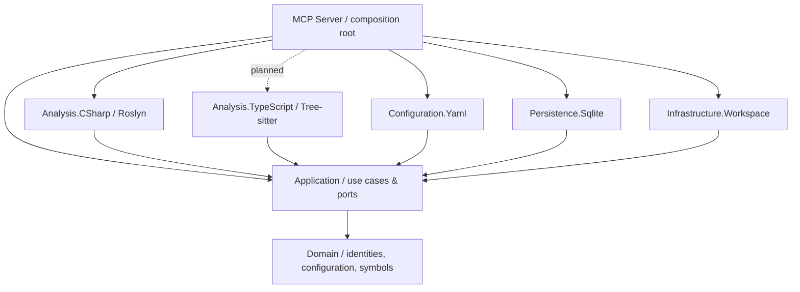
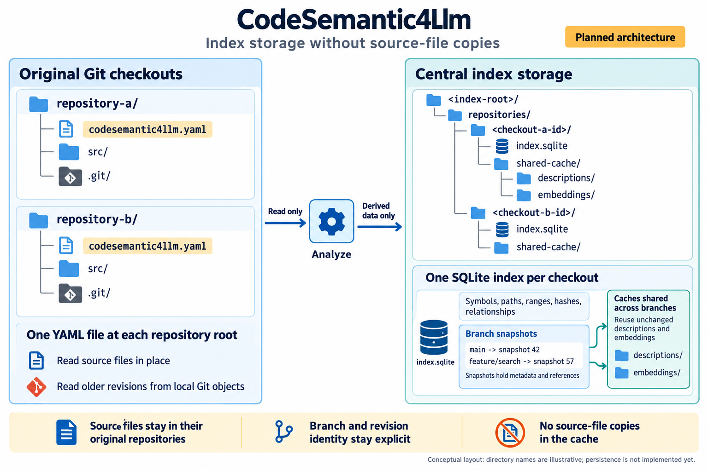

# Architecture

The optional [shared summary cache](shared-summaries.md) distributes derived Markdown
through Git while retaining the existing local, branch-scoped SQLite/FTS5 snapshots.
Its import, export, watcher and conflict policies follow the same dependency boundaries.

## Dependency direction

The domain has no dependencies on Git, Roslyn, Tree-sitter, YAML, SQLite or MCP.
The application owns the ports. Adapters depend inward; the MCP executable is the only composition root.

## Console commands and MCP transport

`Program.cs` wires dependency injection, output streams and cancellation. Spectre.Console.Cli
dispatches `init`, `preview`, `index` and `serve` to separate commands with declarative settings.
The default command starts the same stdio MCP server as `serve`. A small type registrar
bridges Spectre to Microsoft dependency injection and disposes each run's service provider.
Application use cases and adapters have no dependency on Spectre.

`serve [repository-path]` has its own settings and delegates to the same host composition
as the argument-free default command. Keeping the default command argument-free ensures
that unknown command names remain errors rather than becoming repository paths. A supplied
path must be an existing directory and is normalized relative to the process working directory.
The host adds it as a final configuration override, taking precedence over the environment
without mutating process environment variables. MCP stdout remains protocol-only.

Spectre generates help and parses typed arguments, including repeatable analyzer arrays.
The language option captures occurrences to reject duplicates rather than silently choose
the last value. A shared interceptor rejects arguments Spectre leaves unbound before a
command runs. This avoids Spectre.Console.Cli 0.57.2's
[strict-parsing retry](https://github.com/spectreconsole/spectre.console.cli/blob/9c88a343b8ce622e9fda4e4334b2057d773d90c9/src/Spectre.Console.Cli/Internal/CommandExecutor.cs#L165), which can
mistake its internal default-command token for a missing option value. No application
code tokenizes or manually consumes CLI options.

Console results and help use stdout; errors use stderr. Dynamic paths and diagnostics
are rendered as plain text rather than interpreted as Spectre markup. The MCP command
keeps stdout exclusively for protocol messages and sends host logs to stderr. Functional
tests exercise the same CLI parser and verify the executable's MCP initialization response.

## Repository-local configuration

Every repository owns its root `codesemantic4llm.yaml`. The YAML adapter parses and
validates it, and the application use case resolves the requested analyzer implementations.
The workspace adapter recursively walks the checkout with effective glob exclusions.
Preview returns bounded candidate paths; indexing processes every selected file. Both use
the same application-owned analyzer resolution and extension selection.

The local `init` command creates default configuration through an application use case.
The application checks all selected analyzers, using C# when no selection is supplied;
the domain normalizes analyzer IDs and validates the semantic description language.
Repeated CLI selections replace the default while preserving analyzer priority.
`Configuration.Yaml` owns serialization and creates the
file in the explicitly selected directory without replacing an existing entry. A temporary
file in that directory is moved into place only after writing completes, so a failed or
canceled initialization does not expose partial YAML. This write operation is local CLI
functionality; MCP preview tools remain read-only.

Each language adapter owns its default file extensions (`.cs` for C#). The domain models
validated, immutable extension selections, and the YAML adapter maps optional per-analyzer
overrides. The application checks analyzer availability, resolves overrides against defaults,
and selects candidate paths. An override replaces only that analyzer's extension list;
it does not change its parser or bypass exclusions. Keeping defaults with the adapter avoids
a central language-extension registry that would need updating for every new language.
The generic filesystem walker remains independent of language selection.

The supported analyzer IDs are separate from source language identifiers (for example,
`dotnet-csharp` is an analyzer, `csharp` is the language). Unsupported analyzers fail
explicitly. The server reads only the checkout selected by the `serve` argument or, when
omitted, `CODESEMANTIC4LLM_REPOSITORY_ROOT`. MCP tool calls cannot submit arbitrary filesystem roots.

An optional `projectName` provides a display label, set by `init --name` or edited in YAML.
The domain validates and trims the name; the YAML adapter owns serialization and mapping.
Configuration and preview responses expose it without replacing checkout/branch identity.
It is excluded from analysis fingerprints and storage paths, so changing a label preserves
reusable declarations and does not require a SQLite schema change.

See [the YAML contract](repository-configuration.md).

## Index boundaries

A repository index must be uniquely identified by a checkout and branch. A branch can have a different source structure even when file paths are identical.

- Preserve the original repository as the source of truth; index storage contains **no source-file copies**.
- Keep symbol/source identities and locations separate from the storage engine.
- Retain a minimal cross-language query projection, while allowing distinct relational tables for C#, TypeScript, F#, and other supported languages.
- Read and validate the current Git branch rather than silently assuming `main`.
- Index working-tree content with file hashes and an observed HEAD revision, without claiming that the tree is clean.
- Remove deleted/renamed records when publishing a replacement snapshot and reject detected branch changes during a run.
- Keep SQLite schema versioned and regenerable; this first declaration schema does not freeze the future language-specific semantic model.

## Implemented declaration snapshots

`IndexRepository` coordinates Git state, YAML configuration, discovery, source reads,
analysis, verification and publication through application-owned ports. `IIndexUpdate`
owns one unpublished generation: disposing it without publication rolls back the update.
`ISourceAnalyzer.IndexVersion` invalidates reused analysis when the compiled adapter changes.
The C# declaration adapter parses syntax independently per file. A second C# adapter now
builds a transient repository-wide compilation and uses Roslyn SemanticModel to bind
explicit references to method and type declarations. This has no MSBuild project graph;
project boundaries, conditional compilation and external NuGet assemblies still require
future compilation-context resolution. Unresolved and ambiguous uses are not guessed.

Roslyn records the immediate containing type's declaration location for each extracted
member. This explicit edge distinguishes nested types and homonymous or generic declarations
even when their display names match. Member queries use the selected type's exact source
location within an expected snapshot, never a qualified-name prefix heuristic. Partial
declarations are kept separate because syntax alone does not establish their compilation
identity; inherited members are also outside this navigation contract.

The SQLite adapter maps a canonical Git checkout root to a SHA-256 directory under an
operator-configurable central cache. One database holds a completed snapshot per named
branch. Snapshot IDs and branch names are database data; no branch name becomes a path.
Source text is read in place, one file at a time, and is never inserted into SQLite.
The declaration pass grows with discovered paths and file metadata; the reference pass
holds Roslyn syntax trees for the selected C# files in memory until binding finishes.
This increases peak memory on large repositories but never persists source copies.

A single writer transaction builds the new snapshot. Unchanged files reuse derived rows
from the same branch when hashes, adapter versions and configuration match. New or changed
files are analyzed; absent paths never enter the replacement snapshot. Publication switches
the branch pointer and deletes the old generation in the same transaction. WAL allows
readers to keep seeing the previous complete snapshot during the write. Read queries use
one transaction to keep snapshot metadata and declaration rows consistent.

Schema 2 added container coordinates and type membership metadata; schema 3 adds a compact
`symbol_references` table keyed by snapshot and target declaration location. References
contain usage path and line/column only, with no copied sources. A version marker on each
snapshot prevents old indexes from falsely reporting no usages. Version-one and version-two
caches are upgraded on the write path, leaving older snapshots usable for supported reads.
Failed publication preserves the previous declarations; missing reference data asks for
reindexing. Reference queries use deterministic bounded pages and snapshot ID guards.

SQLite operations are synchronous because Microsoft.Data.Sqlite executes asynchronous ADO
operations synchronously. Cancellation is checked between files, declarations and statements,
and before commit. Source reads, Git operations and analyzer calls accept cancellation.
The CLI adapts use-case progress to Spectre; completion is emitted only after commit.

Before publication, files are rehashed, paths rediscovered, and Git/configuration reread.
Detected changes abort the run. This is best-effort verification, not an atomic filesystem
snapshot; concurrent editing can still race the final check. Queries expose recorded metadata
and reject a changed HEAD, but do not scan source files to prove working-tree freshness.
See [indexing behavior and limitations](indexing.md).

## Method-local Roslyn syntax diagnostics

`IMethodSyntaxDiagnostics` is the application port for language-specific
syntax feedback. The C# adapter uses Roslyn parsing to report diagnostics on
one selected method or on an in-memory proposed method-body replacement.
It returns error IDs, messages and one-based original/proposed file positions;
no source copies or diagnostic text are persisted in SQLite. Validation shares
the same body normalization and syntax gate as the method editor. Both accept an explicit
block or its inner statements. A leading block is treated as explicit; otherwise a pair
of outer braces is added, using the source file's line endings and separating trailing
line comments from the closing brace. Unbalanced braces and malformed control flow
are rejected. Diagnostic positions refer to the normalized proposed file. Source text
outside the original body span remains unchanged.

`validate_method_body` is a standalone read-only check on current source, selected by
file path and method name, without a prior read or client-managed version metadata.
The body-edit use case runs this same diagnostic contract against the source snapshot
it will edit, before publishing. A `MethodEditValidationException` carries syntax errors
to the MCP presentation, which returns a bounded error response with IDs, messages and
proposed-file positions. This removes a separate validation round trip and a second
transmission of the replacement body. Successful writes retain their compact location
response; the standalone validator remains useful when no write is wanted.

The full-declaration editor uses the same diagnostic exception contract. It retains
Roslyn's recovered method tree while adjusting indentation, then maps parser errors
from the detached replacement into physical positions in the proposed file. This
reports errors in signatures and bodies precisely, even for unterminated strings.
Invalid input shapes additionally receive `CS4L0002`. The MCP presentation bounds
feedback to 10 diagnostics, indicates any remaining count, and directs a retry to
the same editing tool. No build or indexed project code is executed.
When a returned diagnostic is `CS1012`, the error response adds one concise reminder
that C# strings use double quotes and character literals use single quotes. This
failure-only hint does not rewrite submitted literals or add instructions to successful
responses and unrelated syntax errors.
`get_method_diagnostics` reads directly from the operator-selected checkout
and verifies the expected method name and exact identifier position. It
deliberately does **not** require a current snapshot, allowing an agent to
validate a method after editing it. Both MCP tools are registered regardless
of the `--allow-write` switch and bound the response through pagination.

`isValid` means *syntactically valid only*. The adapter does not resolve
project references, perform type checking, invoke build tools or execute code.
Missing symbols, incompatible return types and semantic warnings require a
future project-aware Roslyn compilation workflow.

## Explicitly authorized source editing

The `serve --allow-write` switch sets an immutable `RepositoryWriteAccess` capability
for that host process. It is not derived from YAML, environment configuration or MCP
request parameters. Read-only hosts register `get_method_body` but do not advertise
`replace_method_body`. This is deliberate explicit tool registration rather than
assembly-wide automatic discovery; the use case independently checks write permission.

The `CurrentMethodOperations` application use case selects the current method by
file path and name, with an optional identifier position to disambiguate overloads.
It reads source within each write call and delegates C# parsing to
`IMethodBodyEditor`. Roslyn locates the exact `MethodDeclarationSyntax` and validates
the replacement as one executable C# block. It replaces the body's character span,
not the whole declaration or file, preserving unrelated source text. Full-method
replacement uses `IMethodDeclarationEditor` to replace attributes, signature and body.

Writes have no read-history prerequisite and accept no client-supplied file or method
hash. This deliberately permits direct edits and edits after a server restart. The
trade-off is that source changes made before the write call are accepted, even if the
model previously read a different version. The use case checks checkout state again
before publishing, and the writer checks the file version captured during that same
call. Those internal checks catch ordinary concurrent modifications during the edit;
they do not establish that the model saw the current source.

Indentation belongs to the C# editing adapter rather than the MCP caller. The shared
replacement preparation used by writing and syntax validation rebases the body's common
indentation to the selected declaration, inferring a local indent step from existing
statements or enclosing declarations. It preserves relative inner indentation and inline
formatting, and uses Roslyn token/trivia boundaries to leave multiline literals, comment
contents and inactive preprocessor text intact. This avoids whole-file formatting and an
additional workspace dependency; it does not implement `.editorconfig` formatting rules.

`IRepositorySourceWriter` owns the actual checkout edit. Its filesystem implementation
rejects path traversal and symbolic links, checks the expected hash again just before
replacement, preserves UTF-8 BOM and Unix file mode, and uses a temporary sibling
rename so incomplete writes are not exposed. Non-UTF-8 files are refused. The
check-plus-rename is best-effort optimistic concurrency, **not** a cross-process
atomic compare-and-swap. Concurrent checkout edits may still race. No new code or
source copies are persisted into the central index; a successful write marks the
index stale and requires an explicit reindex.

## Repository-selected MCP tools

`McpToolCatalog` declares every tool a repository server can advertise, with the capability it
belongs to. The catalog is domain vocabulary rather than transport detail: it is the contract
offered to agents, and both the YAML loader and the `init` use case need it, while the MCP host
remains the only place that registers tools. A functional scenario serves a checkout with every
capability granted and asserts that discovery returns exactly the catalog, so registration and
catalog cannot drift apart.

`McpToolSelection` is the validated set a repository allows. Unknown names fail explicitly with
the available list, mirroring unsupported analyzer IDs; names are trimmed, lowercased and
deduplicated, and discovery always returns catalog order. A repository that declares no `tools`
section selects every tool, so earlier configurations keep working. A section that selects
nothing is an error instead of a silent return to advertising everything, because commenting out
every entry expresses the opposite intent. Distinguishing an absent section from an empty one is
the loader's responsibility; the domain only sees a selection or none.

A selection **narrows** and never widens. `RepositoryWriteAccess` and `McpToolExposure` still
decide which tool classes are registered at all, so listing `replace_method_body` in YAML cannot
grant source editing, and an unregistered tool is refused as unknown. On top of that
registration, a list-tools filter hides deselected tools and a call-tools filter refuses them, so
a client holding a stale tool list cannot reach a tool the repository withdrew. Filtering the
response rather than the registrations keeps the SDK's reusable tool definitions untouched, as
project descriptions already do.

The selection is read per request, like the project display name, so an operator's edit applies
after the client refreshes its tool list. When the configuration cannot be read, the process
capabilities remain the only restriction and a warning goes to stderr: discovery and file
diagnostics must stay usable on an unconfigured or broken checkout, and withholding every tool
there would make the server useless rather than safer. Operations that require valid
configuration keep failing as before. A selection is a presentation choice: it does not affect
analysis fingerprints, stored data or cache identity, so narrowing it never requires reindexing.

## Planned index storage

The illustration describes the broader intended architecture. One database per checkout
and branch snapshots are implemented as described above. Directory labels in the image
are illustrative; shared cross-branch caches, historical source lookup, descriptions and
embeddings remain planned.

- Each original checkout owns `codesemantic4llm.yaml` at its root, alongside `src/` and
  `.git/` in the example. The YAML belongs to the repository, never to the central cache.
  See the [repository-local YAML contract](repository-configuration.md) for supported keys.
- The intended design uses one SQLite index per checkout, shared by that checkout's
  branches. Each branch points to an explicit snapshot of derived index data. Snapshots
  are logical metadata and references, not copies of the source tree or separate databases
  per branch. Branch names are labels, not filesystem directory names.
- Persist symbol identities, relationships, source paths and ranges, hashes, and revision
  identifiers. Read current source files in place and historical versions from local Git
  objects. Never copy source files or Git objects into the central index storage.
- Read a source excerpt only from the requested revision or a working-tree version whose
  content matches the indexed hash. If the exact version is unavailable, the planned lookup
  returns `source_unavailable` rather than substituting another branch's source.
- Reuse derived descriptions and embeddings across branches of the same checkout when
  their inputs are unchanged. Reuse must account for content hashes and all relevant
  analyzer, model, and generation settings, including `semanticIndexing.language` for
  natural-language descriptions. Shared caches do not merge branch-specific index records.

The [image generation prompt](index-storage-architecture.prompt.txt) is included for future updates.

## First usable slice

The MCP host starts with the official .NET SDK and stdio transport.
The C# parser extracts syntax-level declarations without executing project code.
The YAML adapter reads project-specific exclusions and extension overrides; the application
resolves enabled analyzers and their effective extensions during recursive filesystem discovery.
The `index` command persists all selected declarations and exposes them through bounded
MCP queries, without executing project code or storing source contents. It now resolves references with a transient lightweight compilation, without loading
MSBuild project graphs or generating natural-language text.

## Project dependency rules

MCP tool-result serialization uses a copy of the SDK's default JSON settings with
`JavaScriptEncoder.UnsafeRelaxedJsonEscaping`. Results are JSON carried in MCP text,
not HTML. This preserves C# operators, apostrophes and Unicode characters while still
escaping quotes, backslashes and control characters as required by JSON. It avoids
introducing `\u0022`/`\u002B` into model-facing source text, where a model might copy
them into code. Wire-level JSON and logging keep their own encoding; no source string
is decoded, repaired or rewritten. Tests inspect the text content before parsing its
inner JSON and verify exact read/edit round trips, including intentional C# escapes.

The default MCP presentation selects declarations by file path and simple or qualified
name, optionally narrowed by the identifier position. It has no ephemeral symbol IDs.
`CurrentMethodOperations` resolves methods from current Roslyn analysis, independently
of index generations. Method read observations retain only metadata for consistent
pagination; writes do not consume them or require a preceding read. Ambiguous names
require a position instead of an arbitrary overload selection.
`DeclarationSelector` also accepts abbreviated qualified names as literal dot-delimited
suffixes. Current-source selection and SQLite navigation apply the same case-sensitive
rule, scoped to the requested file and position. Every candidate participates in the
ambiguity check, even when one qualified name matches exactly; no exact-match preference
or approximate-name scoring can silently select a different declaring type. SQLite uses
literal suffix comparison rather than wildcard matching, with no schema change.

Navigation resolves addresses through `IIndexStore` and verifies the target source hash.
Navigation and diagnostic continuations retain independent query/version metadata to
prevent mixing pages. Code requests and responses never expose file hashes or snapshots.
`serve --expose-indexing` adds configuration, preview and index-status tools independently
of write permission, leaving the code contracts unchanged. Index refresh remains an
operator operation. Internal snapshot-based application APIs remain available for
direct callers and tests; they are not advertised as MCP code tools. Technical errors go to stderr and
optionally the configured log file.

1. `Domain` references nothing in this solution.
2. `Application` may reference `Domain`, never a concrete adapter.
3. Each parser stays in its own assembly and implements application-owned contracts.
4. `Configuration.Yaml` owns serialization, deserialization and schema validation; it has no knowledge of SQLite.
5. `Persistence.Sqlite` owns SQL and schema migrations, not language parsing.
6. `Infrastructure.Workspace` owns Git/process and filesystem integration.
7. `Mcp.Server` owns transport, DTO shaping, logging configuration, and dependency injection.
8. Tests target layers directly; Reqnroll scenarios exercise YAML, discovery, commands, real temporary Git checkouts, SQLite snapshots and MCP query boundaries.

## Central Package Management

`Directory.Packages.props` is the single source for **all direct NuGet versions**.
Do not add a `Version` attribute or versioned `PackageReference` to project files. Prefer a small, explicit dependency graph over shared dumping-ground projects.
