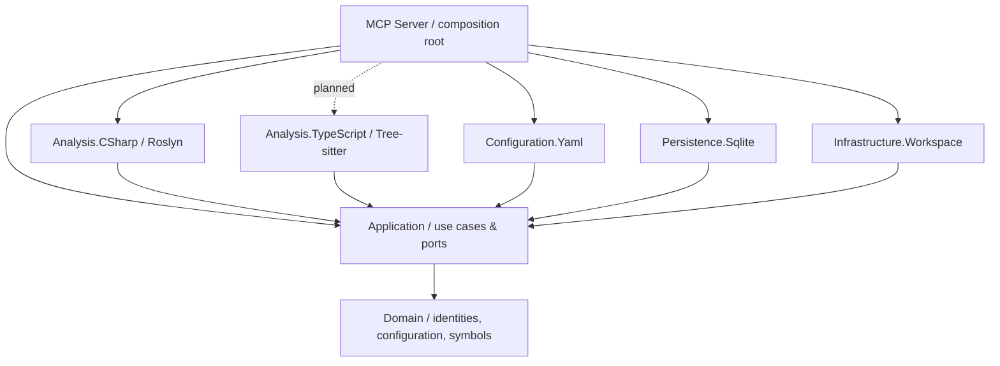

# Architecture

## Dependency direction

The domain has no dependencies on Git, Roslyn, Tree-sitter, YAML, SQLite or MCP.
The application owns the ports. Adapters depend inward; the MCP executable is the only composition root.

## Repository-local configuration

Every repository owns its root `codesemantic4llm.yaml`. The YAML adapter parses and
validates it, and the application use case resolves the requested analyzer implementations.
The workspace adapter recursively walks the checkout with effective glob exclusions. The first slice is
a **read-only preview**, not a persistent indexer.

Each language adapter owns its default file extensions (`.cs` for C#). The domain models
validated, immutable extension selections, and the YAML adapter maps optional per-analyzer
overrides. The application checks analyzer availability, resolves overrides against defaults,
and selects candidate paths. An override replaces only that analyzer's extension list;
it does not change its parser or bypass exclusions. Keeping defaults with the adapter avoids
a central language-extension registry that would need updating for every new language.
The generic filesystem walker remains independent of language selection.

The supported analyzer IDs are separate from source language identifiers (for example,
`dotnet-csharp` is an analyzer, `csharp` is the language). Unsupported analyzers fail
explicitly. The server reads only the checkout selected by
`CODESEMANTIC4LLM_REPOSITORY_ROOT`; MCP clients cannot submit arbitrary filesystem roots.

See [the YAML contract](repository-configuration.md).

## Index boundaries

A repository index must be uniquely identified by a checkout and branch. A branch can have a different source structure even when file paths are identical.

- Preserve the original repository as the source of truth; index storage contains **no source-file copies**.
- Keep symbol/source identities and locations separate from the storage engine.
- Retain a minimal cross-language query projection, while allowing distinct relational tables for C#, TypeScript, F#, and other supported languages.
- Read and validate the current Git branch rather than silently assuming `main`.
- Handle dirty working trees, branch switches, file renames and stale records explicitly when incremental indexing is implemented.
- SQLite schema and index-generation lifecycle are **not frozen by this bootstrap**. The current SQLite adapter provides only a connection boundary.

## Planned index storage

The illustration describes the intended architecture, **not an implemented storage layout**.
Directory names, database names, and snapshot numbers are illustrative; the cache root,
physical layout, and SQLite schema remain to be defined. The current server provides
repository configuration and a read-only preview, not persistent indexing.

- Each original checkout owns `codesemantic4llm.yaml` at its root, alongside `src/` and
  `.git/` in the example. The YAML belongs to the repository, never to the central cache.
  See the [repository-local YAML contract](repository-configuration.md) for supported keys.
- The intended design uses one SQLite index per checkout, shared by that checkout's
  branches. Each branch points to an explicit snapshot of derived index data. Snapshots
  are logical metadata and references, not copies of the source tree or separate databases
  per branch. Branch names are labels, not filesystem directory names.
- Persist symbol identities, relationships, source paths and ranges, hashes, and revision
  identifiers. Read current source files in place and historical versions from local Git
  objects. Never copy source files or Git objects into the central index storage.
- Read a source excerpt only from the requested revision or a working-tree version whose
  content matches the indexed hash. If the exact version is unavailable, the planned lookup
  returns `source_unavailable` rather than substituting another branch's source.
- Reuse derived descriptions and embeddings across branches of the same checkout when
  their inputs are unchanged. Reuse must account for content hashes and all relevant
  analyzer, model, and generation settings, including `semanticIndexing.language` for
  natural-language descriptions. Shared caches do not merge branch-specific index records.

The [image generation prompt](index-storage-architecture.prompt.txt) is included for future updates.

## First usable slice

The MCP host starts with the official .NET SDK and stdio transport.
The C# parser extracts syntax-level declarations without executing project code.
The YAML adapter reads project-specific exclusions and extension overrides; the application
resolves enabled analyzers and their effective extensions during recursive filesystem discovery.
No source code is persisted, and no repository indexing is advertised as implemented.

Next, implement an index transaction boundary that can publish complete, consistent generations while processing files in bounded batches. Branches must never share index records implicitly.

## Project dependency rules

1. `Domain` references nothing in this solution.
2. `Application` may reference `Domain`, never a concrete adapter.
3. Each parser stays in its own assembly and implements application-owned contracts.
4. `Configuration.Yaml` owns deserialization and schema validation; it has no knowledge of SQLite.
5. `Persistence.Sqlite` owns SQL and schema migrations, not language parsing.
6. `Infrastructure.Workspace` owns Git/process and filesystem integration.
7. `Mcp.Server` owns transport, DTO shaping, logging configuration, and dependency injection.
8. Tests target layers directly; Reqnroll scenarios verify YAML + file-discovery behavior without MCP/SQLite.

## Central Package Management

`Directory.Packages.props` is the single source for **all direct NuGet versions**.
Do not add a `Version` attribute or versioned `PackageReference` to project files. Prefer a small, explicit dependency graph over shared dumping-ground projects.
