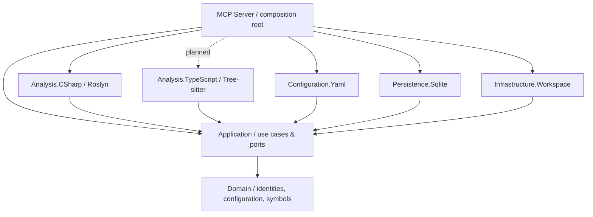

# Architecture

## Dependency direction

The domain has no dependencies on Git, Roslyn, Tree-sitter, YAML, SQLite or MCP.
The application owns the ports. Adapters depend inward; the MCP executable is the only composition root.

## Console commands and MCP transport

`Program.cs` wires dependency injection, output streams and cancellation. Spectre.Console.Cli
dispatches `init`, `preview`, `index` and `serve` to separate commands with declarative settings.
The default command starts the same stdio MCP server as `serve`. A small type registrar
bridges Spectre to Microsoft dependency injection and disposes each run's service provider.
Application use cases and adapters have no dependency on Spectre.

`serve [repository-path]` has its own settings and delegates to the same host composition
as the argument-free default command. Keeping the default command argument-free ensures
that unknown command names remain errors rather than becoming repository paths. A supplied
path must be an existing directory and is normalized relative to the process working directory.
The host adds it as a final configuration override, taking precedence over the environment
without mutating process environment variables. MCP stdout remains protocol-only.

Spectre generates help and parses typed arguments, including repeatable analyzer arrays.
The language option captures occurrences to reject duplicates rather than silently choose
the last value. A shared interceptor rejects arguments Spectre leaves unbound before a
command runs. This avoids Spectre.Console.Cli 0.57.2's
[strict-parsing retry](https://github.com/spectreconsole/spectre.console.cli/blob/9c88a343b8ce622e9fda4e4334b2057d773d90c9/src/Spectre.Console.Cli/Internal/CommandExecutor.cs#L165), which can
mistake its internal default-command token for a missing option value. No application
code tokenizes or manually consumes CLI options.

Console results and help use stdout; errors use stderr. Dynamic paths and diagnostics
are rendered as plain text rather than interpreted as Spectre markup. The MCP command
keeps stdout exclusively for protocol messages and sends host logs to stderr. Functional
tests exercise the same CLI parser and verify the executable's MCP initialization response.

## Repository-local configuration

Every repository owns its root `codesemantic4llm.yaml`. The YAML adapter parses and
validates it, and the application use case resolves the requested analyzer implementations.
The workspace adapter recursively walks the checkout with effective glob exclusions.
Preview returns bounded candidate paths; indexing processes every selected file. Both use
the same application-owned analyzer resolution and extension selection.

The local `init` command creates default configuration through an application use case.
The application checks all selected analyzers, using C# when no selection is supplied;
the domain normalizes analyzer IDs and validates the semantic description language.
Repeated CLI selections replace the default while preserving analyzer priority.
`Configuration.Yaml` owns serialization and creates the
file in the explicitly selected directory without replacing an existing entry. A temporary
file in that directory is moved into place only after writing completes, so a failed or
canceled initialization does not expose partial YAML. This write operation is local CLI
functionality; MCP preview tools remain read-only.

Each language adapter owns its default file extensions (`.cs` for C#). The domain models
validated, immutable extension selections, and the YAML adapter maps optional per-analyzer
overrides. The application checks analyzer availability, resolves overrides against defaults,
and selects candidate paths. An override replaces only that analyzer's extension list;
it does not change its parser or bypass exclusions. Keeping defaults with the adapter avoids
a central language-extension registry that would need updating for every new language.
The generic filesystem walker remains independent of language selection.

The supported analyzer IDs are separate from source language identifiers (for example,
`dotnet-csharp` is an analyzer, `csharp` is the language). Unsupported analyzers fail
explicitly. The server reads only the checkout selected by the `serve` argument or, when
omitted, `CODESEMANTIC4LLM_REPOSITORY_ROOT`. MCP tool calls cannot submit arbitrary filesystem roots.

An optional `projectName` provides a display label, set by `init --name` or edited in YAML.
The domain validates and trims the name; the YAML adapter owns serialization and mapping.
Configuration and preview responses expose it without replacing checkout/branch identity.
It is excluded from analysis fingerprints and storage paths, so changing a label preserves
reusable declarations and does not require a SQLite schema change.

See [the YAML contract](repository-configuration.md).

## Index boundaries

A repository index must be uniquely identified by a checkout and branch. A branch can have a different source structure even when file paths are identical.

- Preserve the original repository as the source of truth; index storage contains **no source-file copies**.
- Keep symbol/source identities and locations separate from the storage engine.
- Retain a minimal cross-language query projection, while allowing distinct relational tables for C#, TypeScript, F#, and other supported languages.
- Read and validate the current Git branch rather than silently assuming `main`.
- Index working-tree content with file hashes and an observed HEAD revision, without claiming that the tree is clean.
- Remove deleted/renamed records when publishing a replacement snapshot and reject detected branch changes during a run.
- Keep SQLite schema versioned and regenerable; this first declaration schema does not freeze the future language-specific semantic model.

## Implemented declaration snapshots

`IndexRepository` coordinates Git state, YAML configuration, discovery, source reads,
analysis, verification and publication through application-owned ports. `IIndexUpdate`
owns one unpublished generation: disposing it without publication rolls back the update.
`ISourceAnalyzer.IndexVersion` invalidates reused analysis when the compiled adapter changes.
The C# declaration adapter parses syntax independently per file. A second C# adapter now
builds a transient repository-wide compilation and uses Roslyn SemanticModel to bind
explicit references to method and type declarations. This has no MSBuild project graph;
project boundaries, conditional compilation and external NuGet assemblies still require
future compilation-context resolution. Unresolved and ambiguous uses are not guessed.

Roslyn records the immediate containing type's declaration location for each extracted
member. This explicit edge distinguishes nested types and homonymous or generic declarations
even when their display names match. Member queries use the selected type's exact source
location within an expected snapshot, never a qualified-name prefix heuristic. Partial
declarations are kept separate because syntax alone does not establish their compilation
identity; inherited members are also outside this navigation contract.

The SQLite adapter maps a canonical Git checkout root to a SHA-256 directory under an
operator-configurable central cache. One database holds a completed snapshot per named
branch. Snapshot IDs and branch names are database data; no branch name becomes a path.
Source text is read in place, one file at a time, and is never inserted into SQLite.
The declaration pass grows with discovered paths and file metadata; the reference pass
holds Roslyn syntax trees for the selected C# files in memory until binding finishes.
This increases peak memory on large repositories but never persists source copies.

A single writer transaction builds the new snapshot. Unchanged files reuse derived rows
from the same branch when hashes, adapter versions and configuration match. New or changed
files are analyzed; absent paths never enter the replacement snapshot. Publication switches
the branch pointer and deletes the old generation in the same transaction. WAL allows
readers to keep seeing the previous complete snapshot during the write. Read queries use
one transaction to keep snapshot metadata and declaration rows consistent.

Schema 2 added container coordinates and type membership metadata; schema 3 adds a compact
`symbol_references` table keyed by snapshot and target declaration location. References
contain usage path and line/column only, with no copied sources. A version marker on each
snapshot prevents old indexes from falsely reporting no usages. Version-one and version-two
caches are upgraded on the write path, leaving older snapshots usable for supported reads.
Failed publication preserves the previous declarations; missing reference data asks for
reindexing. Reference queries use deterministic bounded pages and snapshot ID guards.

SQLite operations are synchronous because Microsoft.Data.Sqlite executes asynchronous ADO
operations synchronously. Cancellation is checked between files, declarations and statements,
and before commit. Source reads, Git operations and analyzer calls accept cancellation.
The CLI adapts use-case progress to Spectre; completion is emitted only after commit.

Before publication, files are rehashed, paths rediscovered, and Git/configuration reread.
Detected changes abort the run. This is best-effort verification, not an atomic filesystem
snapshot; concurrent editing can still race the final check. Queries expose recorded metadata
and reject a changed HEAD, but do not scan source files to prove working-tree freshness.
See [indexing behavior and limitations](indexing.md).

## Planned index storage

The illustration describes the broader intended architecture. One database per checkout
and branch snapshots are implemented as described above. Directory labels in the image
are illustrative; shared cross-branch caches, historical source lookup, descriptions and
embeddings remain planned.

- Each original checkout owns `codesemantic4llm.yaml` at its root, alongside `src/` and
  `.git/` in the example. The YAML belongs to the repository, never to the central cache.
  See the [repository-local YAML contract](repository-configuration.md) for supported keys.
- The intended design uses one SQLite index per checkout, shared by that checkout's
  branches. Each branch points to an explicit snapshot of derived index data. Snapshots
  are logical metadata and references, not copies of the source tree or separate databases
  per branch. Branch names are labels, not filesystem directory names.
- Persist symbol identities, relationships, source paths and ranges, hashes, and revision
  identifiers. Read current source files in place and historical versions from local Git
  objects. Never copy source files or Git objects into the central index storage.
- Read a source excerpt only from the requested revision or a working-tree version whose
  content matches the indexed hash. If the exact version is unavailable, the planned lookup
  returns `source_unavailable` rather than substituting another branch's source.
- Reuse derived descriptions and embeddings across branches of the same checkout when
  their inputs are unchanged. Reuse must account for content hashes and all relevant
  analyzer, model, and generation settings, including `semanticIndexing.language` for
  natural-language descriptions. Shared caches do not merge branch-specific index records.

The [image generation prompt](index-storage-architecture.prompt.txt) is included for future updates.

## First usable slice

The MCP host starts with the official .NET SDK and stdio transport.
The C# parser extracts syntax-level declarations without executing project code.
The YAML adapter reads project-specific exclusions and extension overrides; the application
resolves enabled analyzers and their effective extensions during recursive filesystem discovery.
The `index` command persists all selected declarations and exposes them through bounded
MCP queries, without executing project code or storing source contents. It now resolves references with a transient lightweight compilation, without loading
MSBuild project graphs or generating natural-language text.

## Project dependency rules

1. `Domain` references nothing in this solution.
2. `Application` may reference `Domain`, never a concrete adapter.
3. Each parser stays in its own assembly and implements application-owned contracts.
4. `Configuration.Yaml` owns serialization, deserialization and schema validation; it has no knowledge of SQLite.
5. `Persistence.Sqlite` owns SQL and schema migrations, not language parsing.
6. `Infrastructure.Workspace` owns Git/process and filesystem integration.
7. `Mcp.Server` owns transport, DTO shaping, logging configuration, and dependency injection.
8. Tests target layers directly; Reqnroll scenarios exercise YAML, discovery, commands, real temporary Git checkouts, SQLite snapshots and MCP query boundaries.

## Central Package Management

`Directory.Packages.props` is the single source for **all direct NuGet versions**.
Do not add a `Version` attribute or versioned `PackageReference` to project files. Prefer a small, explicit dependency graph over shared dumping-ground projects.
