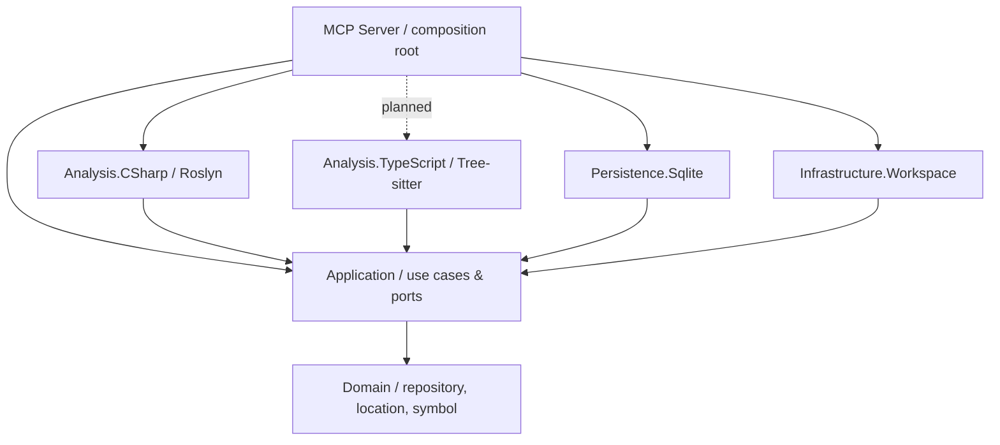

# Architecture

## Dependency direction

The domain has no dependencies on Git, Roslyn, Tree-sitter, SQLite or MCP.
The application owns the ports. Adapters depend inward; the MCP executable is the only composition root.

## Index boundaries

A repository index must be uniquely identified by a checkout and branch. A branch can have a different source structure even when file paths are identical.

- Preserve the original repository as the source of truth; index storage contains **no source-file copies**.
- Keep symbol/source identities and locations separate from the storage engine.
- Retain a minimal cross-language query projection, while allowing distinct relational tables for C#, TypeScript, F#, and other supported languages.
- Read and validate the current Git branch rather than silently assuming `main`.
- Handle dirty working trees, branch switches, file renames and stale records explicitly when incremental indexing is implemented.
- SQLite schema and index-generation lifecycle are **not frozen by this bootstrap**. The current SQLite adapter provides only a connection boundary.

## First usable slice

The MCP host starts with the official .NET SDK and stdio transport.
The C# parser extracts syntax-level declarations without executing project code.
No source code is persisted, and no repository indexing is advertised as implemented.

Next, implement an index transaction boundary that can publish complete, consistent generations while processing files in bounded batches. Branches must never share index records implicitly.

## Project dependency rules

1. `Domain` references nothing in this solution.
2. `Application` may reference `Domain`, never a concrete adapter.
3. Each parser stays in its own assembly and implements application-owned contracts.
4. `Persistence.Sqlite` owns SQL and schema migrations, not language parsing.
5. `Infrastructure.Workspace` owns Git/process and filesystem integration.
6. `Mcp.Server` owns transport, DTO shaping, logging configuration, and dependency injection.
7. Tests target each layer directly; avoid requiring an MCP host for domain/parser tests.

## Central Package Management

`Directory.Packages.props` is the single source for **all direct NuGet versions**.
Do not add a `Version` attribute or versioned `PackageReference` to project files. Prefer a small, explicit dependency graph over shared dumping-ground projects.
