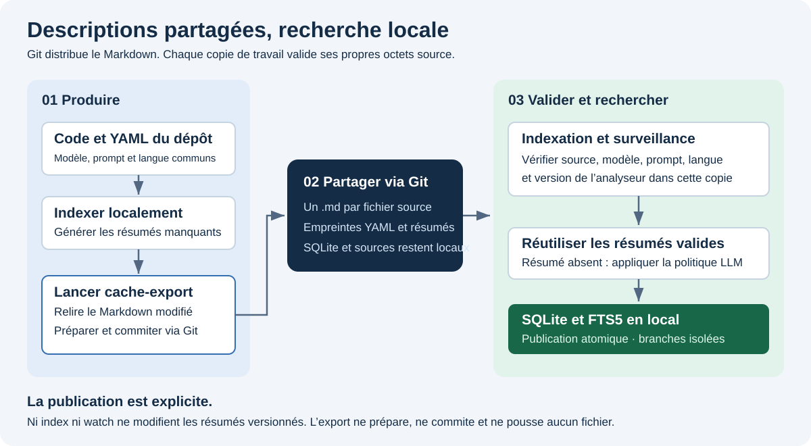
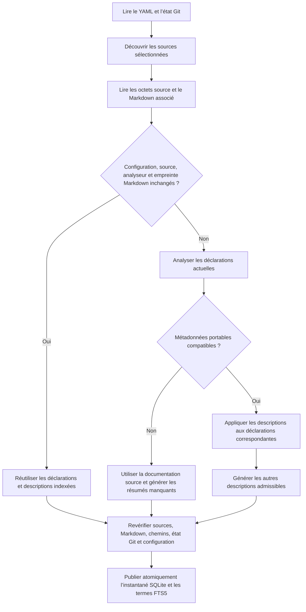
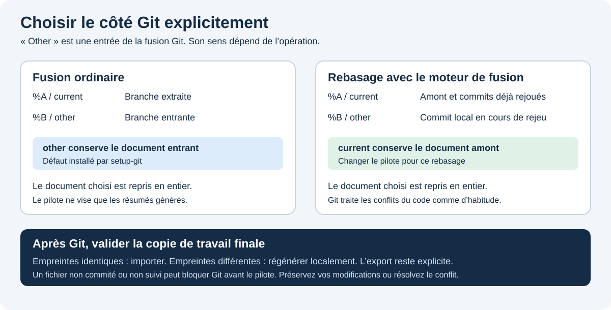

# Partager les résumés du LLM avec Git

[English](shared-summaries.md) · **Français**

CodeSemantic4Llm distribue les descriptions générées dans des commits Git ordinaires. SQLite et FTS5 restent locaux à chaque développeur. Un collègue peut récupérer les fichiers Markdown, lancer `index` puis rechercher dans les descriptions compatibles sans reproduire les appels LLM correspondants. Roslyn extrait toujours les déclarations et références du code présent dans sa copie.



## Activer le partage

Conservez les réglages `semanticIndexing` dans `codesemantic4llm.yaml` et ajoutez l’option indépendante de partage :

```yaml
version: 1
analyzers: [dotnet-csharp]
sharedSummaries: true
semanticIndexing:
  language: en
  llm:
    enabled: true
    baseUrl: http://127.0.0.1:1234/v1
    model: your-team-model
    apiKeyEnvironmentVariable: CODESEMANTIC4LLM_LLM_API_KEY
```

Le modèle, le serveur, la langue, `systemPrompt`, l’effort de raisonnement, le budget de jetons et `forceGeneration` proviennent de la même configuration. `sharedSummaries` vaut `false` par défaut. Si le LLM est désactivé, la documentation source est indexée normalement et les descriptions partagées ne sont pas importées.

Utilisez la même compilation publiée de l’outil et la même politique de fins de ligne dans l’équipe. La version de l’analyseur est l’identifiant du module de l’adaptateur compilé. Deux compilations distinctes refusent volontairement leurs descriptions portables respectives. Fixer la version du paquet évite les invalidations inutiles. Les empreintes Markdown normalisent CRLF en LF, mais **les empreintes source portent sur les octets exacts**, BOM et fins de ligne compris. Ce dépôt utilise `* text=auto eol=lf`. Adoptez une politique adaptée à chaque dépôt indexé.

## Parcours en équipe

Depuis la racine du dépôt, avec l’outil installé dans le `PATH` :

```sh
# Chaque développeur installe une fois le pilote de fusion dans sa copie.
codesemantic4llm setup-git .

# Générer les descriptions manquantes en local, puis les exporter explicitement.
codesemantic4llm index .
codesemantic4llm cache-export .
git diff -- .codesemantic4llm/summaries .gitattributes codesemantic4llm.yaml
git add .codesemantic4llm/summaries .gitattributes codesemantic4llm.yaml
git commit -m "Share compatible code summaries"

# Dans l’autre copie : récupérer le commit, vérifier et importer les descriptions.
git pull --no-rebase
codesemantic4llm index .
```

Inspectez les nouveaux fichiers Markdown non suivis en plus de `git diff` avant de les préparer. Commitez les modifications source avec les descriptions correspondantes lorsque pertinent. Aucune commande CodeSemantic4Llm n’ajoute, ne commite, ne pousse, ne remise ni n’abandonne automatiquement des fichiers. Les commandes prennent un chemin explicite : `index /path/to/checkout` fonctionne également.

`cache-export` lit un index local déjà publié et n’appelle pas le LLM. Lancez `index` d’abord : l’export refuse une révision de branche, une configuration ou une empreinte source différente. Un document identique conserve son contenu et son horodatage. Un document existant différent provoque une erreur par défaut. Après relecture de vos modifications locales, `cache-export . --overwrite` autorise son remplacement. Les sources sont vérifiées avant l’export puis avant chaque écriture. Chaque document est publié par renommage atomique dans son répertoire. L’export de plusieurs fichiers n’est pas une transaction globale : un échec tardif peut laisser les documents déjà terminés. Examinez l’erreur, réindexez et relancez l’export.

## Format des fichiers portables

Chaque fichier source sélectionné possède un document Markdown :

```text
repository/
  codesemantic4llm.yaml
  src/Billing.cs
  .codesemantic4llm/
    summaries/
      src/Billing.cs.md
```

L’extension `.cs` reste présente avant `.md` pour distinguer les sources de même nom et d’extensions différentes. Les chemins sont relatifs au dépôt avec `/` comme séparateur. Aucune source n’est copiée dans le dossier partagé. `.codesemantic4llm` est exclu de la découverte à toute profondeur.

Voici un exemple illustratif. L’exporteur écrit de vraies empreintes SHA-256 en majuscules à la place des valeurs abrégées :

```markdown
---
schemaVersion: 1
source: src/Billing.cs
sourceHash: <64 uppercase hexadecimal characters>
analyzer: dotnet-csharp
analyzerVersion: <compiled analyzer version>
modelHash: <64 uppercase hexadecimal characters>
promptHash: <64 uppercase hexadecimal characters>
languageHash: <64 uppercase hexadecimal characters>
symbols:
  - qualifiedName: Demo.Billing.Total
    kind: method
    line: 12
    column: 5
---

<!-- codesemantic4llm:summary:0 -->
Calculates the invoice total from the current line items.
```

La liste YAML identifie les déclarations. Le corps Markdown fait foi pour le texte des descriptions. Des commentaires HTML numérotés les délimitent sans encombrer le rendu. Les positions distinguent surcharges et déclarations partielles pour une empreinte source exacte. Modifier une description dans le corps change le texte du prochain import. Préservez les marqueurs et les métadonnées ; régénérez normalement ces dernières au lieu de les éditer.

| Identité | Entrées | Invalidation |
| --- | --- | --- |
| `sourceHash` | Octets originaux exacts | Édition, BOM ou changement de fin de ligne |
| `analyzer` / `analyzerVersion` | Identifiant de l’adaptateur et version compilée | Implémentation d’extraction différente |
| `modelHash` | Serveur, modèle, effort, budget maximal et génération forcée | Modification des réglages de génération |
| `promptHash` | Contrat stable de prompt/sortie et `systemPrompt` facultatif | Modèle de prompt, consignes du dépôt ou sémantique de sortie |
| `languageHash` | Balise validée de langue | Langue des descriptions |
| `summary_cache_hash` local | Markdown entier après normalisation CRLF | Document modifié, supprimé, mal formé ou remplacé |

Les métadonnées portables omettent clés API, noms de variables d’environnement, chemins absolus et horodatages de génération. La rotation des identifiants n’invalide pas les descriptions. Le serveur participe uniquement à une empreinte. Les empreintes attestent la compatibilité, pas l’auteur ni la confiance : relisez les documents comme toute autre modification. Un remplacement du modèle par le fournisseur sous le même nom est indétectable. Modifiez son identité configurée ou régénérez délibérément lorsque cela se produit.

L’export contient les descriptions finales indexées, y compris la documentation source conservée par la politique LLM. Seules les descriptions et métadonnées d’identité sont persistées. Un LLM peut citer des éléments sensibles : relisez le contenu avant le commit.

## Importation et invalidation



L’import a lieu dans `IndexRepository` avant la génération de descriptions. Un document complet et compatible évite tous les appels LLM pour ses descriptions, même avec une base locale neuve. Une base neuve doit quand même analyser les sources. Les entrées manquantes suivent la politique documentation/LLM existante. Une description entrante valide remplace le texte local même si deux développeurs avaient produit des formulations différentes avec les mêmes réglages.

La réutilisation incrémentale se fait par fichier. L’empreinte locale est enregistrée dans `indexed_files` aux côtés de l’empreinte source sans la remplacer. Une modification du seul Markdown entraîne un nouveau traitement de son fichier source et met à jour FTS5 via les déclencheurs SQLite existants. Les autres fichiers réutilisent déclarations et résumés. Toutes les lignes forment une nouvelle génération atomique et les références sont reconstruites si la réutilisation est incomplète. Il ne s’agit pas d’une mise à jour SQL en place limitée au texte du résumé.

Les sources supprimées et anciens chemins de renommage disparaissent de l’instantané publié suivant. Le Markdown d’un chemin qui n’est plus découvert est ignoré. Retirez-le explicitement dans Git en relisant l’export : l’export ne supprime pas les anciens fichiers. SQLite isole les données par dépôt et branche. Git distribue le Markdown appartenant à chaque branche. Le HEAD détaché reste incompatible avec l’indexeur.

YAML mal formé, clés doubles, version inconnue, marqueurs de conflit, chemins incohérents et identités de symboles invalides empêchent la réutilisation. La régénération suit la politique existante sans réécrire le Markdown invalide. Un fichier trop volumineux ou une erreur d’accès interrompt l’opération avec un diagnostic. Limites : 4 Mio en UTF-8 par document, 512 Kio d’en-tête, 10 000 symboles décrits et 32 768 caractères par description. Les contrôles de frontières refusent les remontées de chemin et liens symboliques. Les métadonnées importées ne peuvent créer de déclarations ni rediriger la lecture hors du dépôt.

Les sources, chemins découverts, empreintes Markdown, état Git et configuration sont revérifiés avant publication. Si une entrée change ou si la génération échoue, la transaction est annulée et l’instantané précédent reste disponible. Une recherche peut donc encore exposer cet **ancien** instantané. Corrigez le problème et relancez ou laissez `watch` réessayer.

## Surveillance et vérification au démarrage

```sh
codesemantic4llm watch .
```

`watch` vérifie toute la copie au démarrage, puis écoute les modifications de sources, configuration et Markdown, y compris après pull ou changement de branche. Les événements sont regroupés pendant `watch.debounceSeconds` secondes après la dernière modification (15 par défaut, surcharge possible avec `--debounce-seconds`), puis les indexations sont sérielles. Le surveillant vérifie la syntaxe des sources avant de les indexer : en cas d'erreur, l'index publié précédent reste disponible et la prochaine modification ou vérification périodique relance la tentative. Une vérification toutes les 30 secondes compense les événements perdus, les débordements du mécanisme de surveillance et les métadonnées Git de worktrees liés situées hors du répertoire surveillé. Créations, modifications, suppressions et renommages déclenchent une vérification. Sorties de build et fichiers temporaires d’export sont ignorés.

La surveillance se suspend pendant un merge, rebase, cherry-pick, revert, verrouillage de l’index Git ou présence de chemins non résolus. À la fin, l’événement ou le contrôle périodique suivant valide la copie réelle. Les échecs sont signalés puis réessayés. Une annulation annule la mise à jour inachevée. `index` vérifie également sources et fichiers partagés à chaque appel sans rester en écoute.

Lancez un seul `watch` par copie dans un terminal distinct de `codesemantic4llm serve .`. `serve` ne démarre pas de surveillance et sa politique MCP par défaut reste en lecture seule. Aucun hook Git n’est installé. Sans `watch` ou `index` actif, `git pull` seul ne déclenche aucun LLM. Le surveillant peut appeler le modèle si une description est invalidée.

Quand `sharedSummaries` est activé avec l’indexation LLM, chaque réconciliation réussie du surveillant rafraîchit aussi le Markdown versionné dans `.codesemantic4llm/summaries`, afin que les descriptions soient prêtes à committer avec les changements de sources qui les ont produites. Ce rafraîchissement applique les règles de vérification de `cache-export` et remplace les documents qui diffèrent de l’index publié ; relisez `git diff` avant d’ajouter les fichiers, comme pour un export explicite. Un échec de rafraîchissement n’invalide jamais l’instantané publié : il est signalé puis retenté au cycle suivant. Avec `sharedSummaries` désactivé, le surveillant n’écrit jamais de Markdown et l’export reste une invocation explicite de `cache-export`.

## Politique de conflits Git



`setup-git` ajoute cette règle ciblée à `.gitattributes` en préservant le contenu existant :

```gitattributes
.codesemantic4llm/summaries/** merge=codesemantic-summary text eol=lf
```

Il installe également la configuration Git suivante, **locale et non versionnée** :

```gitconfig
[merge "codesemantic-summary"]
    name = Shared summary: select complete other side
    driver = codesemantic4llm git-merge-summary other "%O" "%A" "%B"
    recursive = binary
```

Commitez `.gitattributes` et lancez `setup-git` dans chaque clone. Un attribut versionné ne peut pas installer un pilote exécutable. Un exécutable manquant fait échouer la fusion. Sans pilote personnalisé configuré, Git peut utiliser la fusion textuelle ordinaire et laisser des conflits. Vérifiez l’installation :

```sh
git config --local --get merge.codesemantic-summary.driver
git check-attr merge -- .codesemantic4llm/summaries/src/Billing.cs.md
```

Le pilote reçoit la politique explicite `other` ou `current` et les fichiers temporaires Git `%O` (ancêtre), `%A` (courant), `%B` (autre). Il valide le format du document choisi, puis écrit le document entier dans `%A`. Il ne mélange jamais le YAML d’un côté avec le texte de l’autre. Il ne compare pas encore les sources pendant le merge : elles peuvent changer avant la fin. L’indexation suivante les valide et régénère les descriptions au besoin.

### Fusion et pull avec fusion

Lors de `git merge topic` ou `git pull --no-rebase`, `other` sélectionne `%B`, la branche en cours de fusion. « Autre » désigne la branche entrante de **cette opération** et ne signifie pas toujours « plus récente » ou « distante ». Un fast-forward propre n’appelle pas le pilote. Git peut aussi l’omettre lorsqu’un côté est inchangé. Les conflits structurels modification/suppression ou renommage/suppression peuvent exiger une résolution explicite.

L’attribut vise uniquement les fichiers de résumés générés. Les sources gardent la résolution habituelle de Git. Évitez un `-X theirs` global au dépôt pour résoudre de la prose générée.

### Rebasage et pull avec rebasage

Avec le moteur de fusion de rebase, `%A` désigne l’amont et les commits déjà rejoués, `%B` le commit local en cours de rejeu. Pour préférer les résumés amont en conflit, choisissez `current` **pour cette opération** :

```sh
git -c 'merge.codesemantic-summary.driver=codesemantic4llm git-merge-summary current "%O" "%A" "%B"' rebase --merge origin/develop
```

L’argument entre guillemets simples fonctionne aussi en PowerShell. Pour un pull avec rebasage :

```sh
git -c 'merge.codesemantic-summary.driver=codesemantic4llm git-merge-summary current "%O" "%A" "%B"' pull --rebase
```

Utilisez le moteur de fusion Git et évitez `rebase --apply`. Si l’opération s’arrête, répétez la surcharge sur `git ... rebase --continue` pour les conflits suivants. Sans elle, `other` favorise le résumé local rejoué en cas de conflit. Les deux choix seront validés ensuite mais expriment des préférences différentes. Ce choix explicite évite de déduire le mode à partir de fichiers temporaires. Ne changez le défaut en `current` durablement que si cette politique convient aussi aux fusions ordinaires.

### Modifications non commitées et fichiers non suivis

Le pilote respecte les protections de la copie de travail. Git peut arrêter un pull avant d’invoquer le pilote s’il écraserait une modification préparée ou non, ou un fichier non suivi. `setup-git`, `index` et `watch` ne remisent ni n’abandonnent ces changements.

Commitez les résumés relus, remisez sources et résumés (`git stash push -u` inclut les fichiers non suivis) ou abandonnez uniquement les modifications générées dont vous avez décidé de vous séparer. La réapplication du stash peut elle-même créer un conflit. Résolvez-le puis lancez `index` sur les sources restaurées. `--overwrite` concerne uniquement l’export. Des changements locaux sans conflit peuvent subsister après fusion ; l’indexeur vérifie les octets réels de la copie.

## Stockage et maintenance

Le schéma SQLite 6 ajoute `indexed_files.summary_cache_hash`. Une indexation en écriture migre les schémas 1 à 5 en conservant descriptions publiées et termes FTS5. Les lectures ne migrent pas les bases. Git ne réécrit aucun ancien schéma ; les fichiers SQLite restent dans le stockage d’index local.

- **Domain** : profil portable, provenance source et identités des descriptions.
- **Application** : import pendant l’indexation, vérification, orchestration de l’export et contrat du prompt.
- **Configuration.Yaml** : lecture stricte et sérialisation du YAML et des en-têtes.
- **Infrastructure.Workspace** : lectures bornées, écritures atomiques, surveillance et configuration Git locale.
- **Persistence.Sqlite** : migration de l’empreinte et lectures d’export transactionnelles. Les déclencheurs existants maintiennent les termes FTS5.
- **Mcp.Server** : composition CLI et générateur compatible OpenAI.

Si vous modifiez le prompt, les valeurs par défaut des requêtes, la sémantique d’extraction ou la normalisation de sortie, actualisez le contrat `CacheVersion` du générateur. En production, la version est dérivée des modèles partagés, du prompt système personnalisé (le cas échéant) et d’une version de normalisation explicite. Les générateurs personnalisés doivent fournir une version stable qui évolue avec leur comportement sémantique. Excluez chemins propres à une machine, horodatages et identifiants secrets des empreintes.

Les spécifications et tests couvrent les imports en base neuve, la modification du Markdown et le remplacement FTS, la réutilisation des fichiers inchangés, l’invalidation par source/modèle/prompt/langue, les suppressions/renommages, l’isolation des branches, les métadonnées mal formées, les contrôles de frontières, le rollback atomique, la protection contre l’écrasement, la surveillance et ses reprises, la migration de schéma ainsi que de vrais scénarios Git de fusion, rebasage et modifications locales. Aucun service LLM réel n’est nécessaire.

Références Git : [pilotes de fusion personnalisés](https://git-scm.com/docs/gitattributes#_defining_a_custom_merge_driver), [sémantique des côtés pendant un rebasage](https://git-scm.com/docs/git-rebase), [préconditions de fusion](https://git-scm.com/docs/git-merge#_pre_merge_checks).
