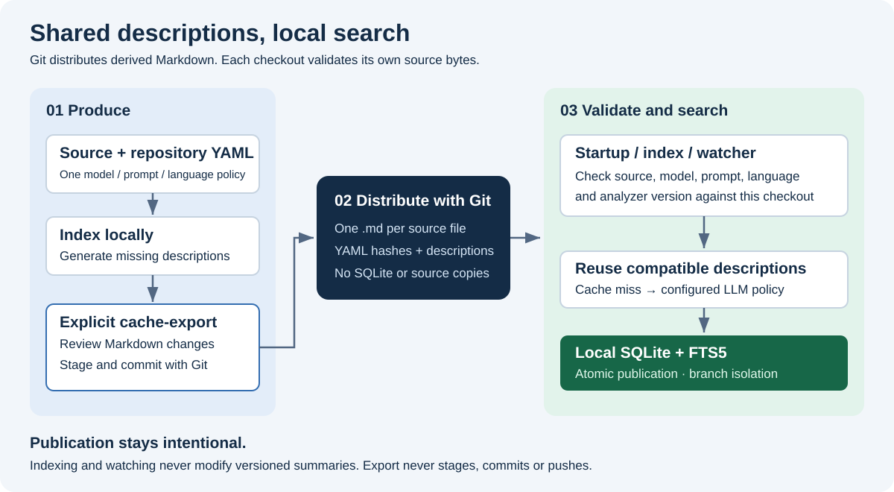
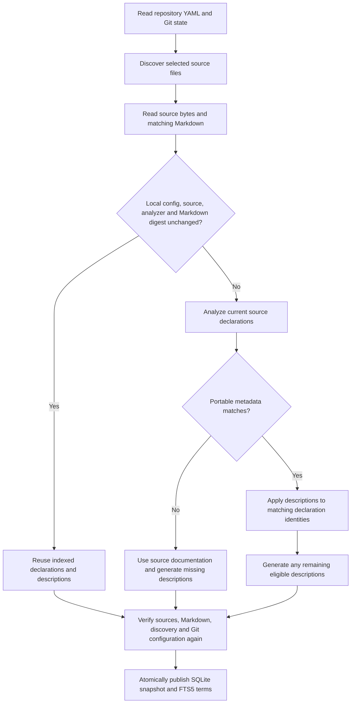
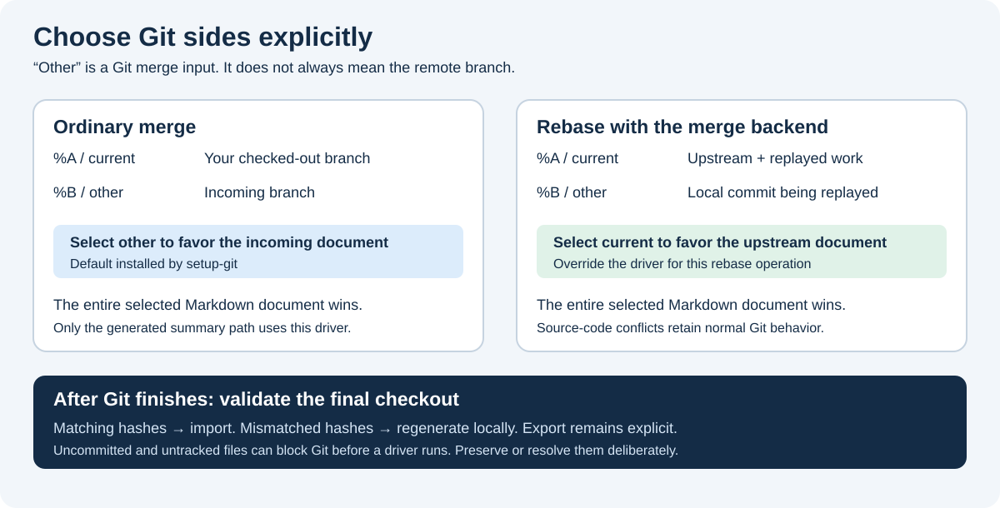

# Shared LLM summaries in Git

**English** · [Français](shared-summaries.fr.md)

CodeSemantic4Llm can distribute generated descriptions through ordinary Git commits while keeping SQLite and FTS5 local to each developer. A colleague can pull the Markdown files, run `index`, and search the descriptions without repeating compatible LLM calls. Roslyn still derives declarations and references from the checked-out source.



## Enable sharing

Keep the existing `semanticIndexing` settings in `codesemantic4llm.yaml`; add the independent opt-in flag:

```yaml
version: 1
analyzers: [dotnet-csharp]
sharedSummaries: true
semanticIndexing:
  language: en
  llm:
    enabled: true
    baseUrl: http://127.0.0.1:1234/v1
    model: your-team-model
    apiKeyEnvironmentVariable: CODESEMANTIC4LLM_LLM_API_KEY
```

The model, endpoint, language, custom `systemPrompt`, reasoning effort, token budget and `forceGeneration` policy continue to come from this one configuration. Sharing does not introduce another model configuration. The default is `sharedSummaries: false`. With LLM indexing disabled, source documentation is indexed normally and shared LLM descriptions are not imported.

Use the same released tool build and source line-ending policy across the team. The current analyzer version is the compiled adapter's module identifier. Different analyzer builds deliberately reject one another's portable descriptions; pinning the tool package avoids unnecessary misses. Markdown digests normalize CRLF to LF, but **source hashes cover exact bytes**, including BOMs and line endings. This repository already uses `* text=auto eol=lf`; adopt an appropriate policy in each indexed repository.

## Team workflow

Run these commands from the repository root with the installed tool on `PATH`:

```sh
# Each developer installs the local executable merge-driver definition once.
codesemantic4llm setup-git .

# Producer: generate missing descriptions locally, then explicitly export them.
codesemantic4llm index .
codesemantic4llm cache-export .
git diff -- .codesemantic4llm/summaries .gitattributes codesemantic4llm.yaml
git add .codesemantic4llm/summaries .gitattributes codesemantic4llm.yaml
git commit -m "Share compatible code summaries"

# Consumer: after receiving the commit, import and verify the descriptions.
git pull --no-rebase
codesemantic4llm index .
```

Inspect new, untracked Markdown files as well as `git diff` before staging. Commit the source changes together with their matching descriptions when appropriate. No CodeSemantic4Llm command stages, commits, pushes, stashes, or discards files automatically. The CLI commands take an explicit repository path, so `index /path/to/checkout` also works.

`cache-export` reads an already published local index. It does **not** call the LLM. Run `index` first; the export refuses a different branch revision, configuration, or source hash. An identical document is left untouched, including its modification time. A different existing document causes an error by default. After reviewing local Markdown edits, `cache-export . --overwrite` permits replacement. Source files are checked before export and again before each write; each document is published with a same-directory atomic rename. An export is not one transaction across all files: a later failure can leave earlier complete documents exported. Review the reported failure and rerun after indexing.

## Portable file format

There is one Markdown document per selected source file:

```text
repository/
  codesemantic4llm.yaml
  src/Billing.cs
  .codesemantic4llm/
    summaries/
      src/Billing.cs.md
```

The `.cs` extension is retained before `.md`, avoiding collisions with other source extensions. Source paths are relative and use `/`; source files are never copied into the shared directory. `.codesemantic4llm` is a built-in discovery exclusion at every depth.

The following is an illustrative document; replace abbreviated hashes with the exporter-generated uppercase SHA-256 values:

```markdown
---
schemaVersion: 1
source: src/Billing.cs
sourceHash: <64 uppercase hexadecimal characters>
analyzer: dotnet-csharp
analyzerVersion: <compiled analyzer version>
modelHash: <64 uppercase hexadecimal characters>
promptHash: <64 uppercase hexadecimal characters>
languageHash: <64 uppercase hexadecimal characters>
symbols:
  - qualifiedName: Demo.Billing.Total
    kind: method
    line: 12
    column: 5
---

<!-- codesemantic4llm:summary:0 -->
Calculates the invoice total from the current line items.
```

The YAML list records declaration identity; the Markdown body is the canonical description text. Numbered HTML comments delimit descriptions without cluttering the rendered Markdown. Locations disambiguate overloads and partial declarations under an exact source hash. Editing a description in the body changes the next imported text; keep the markers and metadata intact. Metadata is generated data and should normally be regenerated rather than manually adjusted.

| Identity | Inputs | Invalidation |
| --- | --- | --- |
| `sourceHash` | Exact original source bytes | Any source edit, BOM or line-ending change |
| `analyzer` / `analyzerVersion` | Adapter ID and compiled adapter version | Different declaration/extraction implementation |
| `modelHash` | Endpoint, model, reasoning effort, max completion tokens, force-generation policy | Changed generation settings |
| `promptHash` | Generator's stable prompt/output contract and optional `systemPrompt` | Changed prompt templates, repository instructions or response semantics |
| `languageHash` | Validated semantic language tag | Changed natural-language output language |
| Local `summary_cache_hash` | Whole Markdown after CRLF normalization | Changed, removed, malformed or replaced shared document |

API keys, environment-variable names, absolute repository paths and generation timestamps are absent from portable metadata. Credential rotation does not invalidate descriptions. The endpoint participates only in a hash. Hashes establish compatibility, not authorship or trust: review shared content as you review other repository changes. A provider replacing a model behind the same model name cannot be detected; update the configured model identity or regenerate deliberately when that happens.

Exports contain the final indexed descriptions, including source documentation retained by the existing LLM policy. Only descriptions and identity metadata are persisted. LLM output can itself quote sensitive source content, so inspect it before committing.

## Import and invalidation



Imports happen inside the existing `IndexRepository` use case, before generating descriptions. A complete compatible document avoids all LLM requests for its descriptions, even in a fresh local database. It does not avoid source analysis in that fresh database. Missing entries fall back to the existing documentation/LLM policy. An incoming valid description replaces local text even when two developers used the same settings and produced different wording.

Incremental reuse is per file. The local digest is persisted in `indexed_files`, alongside the original source hash; it is not substituted for that hash. A summary-only change reprocesses its source file and updates FTS5 through the existing SQLite triggers. Unaffected files reuse their declarations and summaries. As with existing indexing, all rows form a new atomic generation, and references are rebuilt when file-level reuse is incomplete. This is not an in-place, summary-only SQL optimization.

Deleted sources and renamed paths disappear from the next published snapshot. Old Markdown documents for paths no longer discovered are ignored; remove them explicitly in Git when reviewing an export. Export does not prune files. Branches remain isolated by the existing SQLite repository/branch scope, while Git distributes the Markdown belonging to each branch. Detached HEAD remains unsupported by the existing indexer.

Malformed YAML, duplicate keys, unsupported versions, unresolved conflict markers, path mismatches and invalid symbol identities are rejected as cache misses. Regeneration follows the existing LLM policy and does not rewrite the invalid Markdown. Oversized files and filesystem access failures stop the run with a diagnostic. Documents are limited to 4 MiB in UTF-8, 512 KiB of front matter, 10,000 described symbols and 32,768 characters per description. Repository boundary checks reject traversal and symbolic links. Imported metadata cannot create declarations or point the source reader outside the checkout.

Sources, file discovery, Markdown digests, Git state and configuration are checked again before publication. If something changes or generation fails, the transaction rolls back and the previous snapshot remains available. A failure therefore means searches can still expose the **previous** snapshot; it is not a claim that the latest working tree was indexed. Fix the reported error and rerun, or let `watch` retry.

## Watching and startup verification

```sh
codesemantic4llm watch .
```

`watch` verifies the entire checkout on startup, then listens for source, configuration and Markdown changes, including edits introduced by pull and branch switches. Events are coalesced until `watch.debounceSeconds` seconds after the last edit (15 by default, optionally overridden with `--debounce-seconds`) and indexing runs serially. Watch mode checks source syntax before indexing; parser errors keep the last published snapshot visible and are retried on later changes or timer ticks. A 30-second reconciliation timer covers missed events, watcher overflow and linked-worktree Git metadata outside the watched directory. File creation, removal and renames all trigger reconciliation. Build output directories and temporary export files do not trigger it.

The watcher pauses while Git reports a merge, rebase, cherry-pick, revert, index lock or unresolved paths. After the operation completes, the next event or timer scan validates the actual checkout. Failures are reported and retried; cancellation rolls back an unfinished index run. A normal `index` command also verifies sources and shared files on every invocation, but does not remain running.

Run one watcher per checkout in a separate terminal alongside `codesemantic4llm serve .`. `serve` does not automatically start a watcher and its default read-only MCP capability policy is unchanged. No Git hooks are installed, and no LLM requests happen merely because `git pull` runs when neither `watch` nor `index` is active. Watch mode may call the configured LLM when changed code or configuration invalidates a description.

When `sharedSummaries` is enabled with LLM indexing, each successful watch reconciliation also refreshes the versioned Markdown in `.codesemantic4llm/summaries`, so descriptions are ready to commit together with the source changes that produced them. The refresh reuses the `cache-export` verification rules and replaces documents that differ from the published index; review `git diff` before staging, exactly as with an explicit export. A refresh failure never invalidates the published snapshot: it is reported and retried on the next cycle. With `sharedSummaries` disabled, watch mode never writes Markdown and exporting remains an explicit `cache-export` invocation.

## Git conflict policy



`setup-git` appends this scoped rule to `.gitattributes`, preserving existing content:

```gitattributes
.codesemantic4llm/summaries/** merge=codesemantic-summary text eol=lf
```

It also installs the following **local**, unversioned Git configuration:

```gitconfig
[merge "codesemantic-summary"]
    name = Shared summary: select complete other side
    driver = codesemantic4llm git-merge-summary other "%O" "%A" "%B"
    recursive = binary
```

Commit `.gitattributes`; run `setup-git` separately on every clone. Installing an executable driver is deliberately not something a checked-out attribute can do. A missing executable fails the merge; without a configured custom driver, Git can fall back to ordinary text merging and leave conflicts. Check installation with:

```sh
git config --local --get merge.codesemantic-summary.driver
git check-attr merge -- .codesemantic4llm/summaries/src/Billing.cs.md
```

The driver takes an explicit `other` or `current` policy and Git's `%O` (ancestor), `%A` (current), `%B` (other) temporary files. It validates the selected document's format and writes a complete selected document into `%A`. It never combines YAML from one side with prose from another. It deliberately does not compare the source while Git is merging: the source might not yet have reached its final state. The subsequent index run performs that validation and regenerates descriptions if needed.

### Merge / pull with merge

During `git merge topic` or `git pull --no-rebase`, `other` selects `%B`, the branch being merged. That is the incoming branch for this operation; it is not a universal concept of “newest” or “remote.” Clean fast-forwards do not invoke a merge driver. Git also need not invoke it for an unchanged side, and structural conflicts such as modify/delete or rename/delete may still require explicit resolution.

The attribute applies only to generated summary files. Source conflicts retain Git's normal behavior. Do not use a repository-wide `-X theirs` merely to resolve generated prose.

### Rebase / pull with rebase

During a rebase using Git's merge backend, `%A` is the upstream branch plus commits already replayed; `%B` is the local commit currently being replayed. To favor upstream summaries for the conflicting content, use `current` **for that operation**:

```sh
git -c 'merge.codesemantic-summary.driver=codesemantic4llm git-merge-summary current "%O" "%A" "%B"' rebase --merge origin/develop
```

The same single-quoted argument works in PowerShell. For a pull with rebase:

```sh
git -c 'merge.codesemantic-summary.driver=codesemantic4llm git-merge-summary current "%O" "%A" "%B"' pull --rebase
```

Use Git's merge backend, not `rebase --apply`. If the operation stops, repeat the override on `git ... rebase --continue` for subsequent conflicts. Without the override, the installed `other` policy favors the replayed local summary in conflicts. Either choice is safe to *validate* afterwards, but they express different preferences. This explicit policy avoids unreliable guesses based on the presence of temporary rebase files. Do not permanently change the default to `current` unless that is the policy you intend for ordinary merges too.

### Uncommitted and untracked files

A merge driver does not bypass Git's working-tree protections. Git can stop before invoking it if a pull would overwrite unstaged/staged changes or an untracked file. `setup-git`, `index` and `watch` do not stash or discard those edits.

Choose deliberately: commit the reviewed summaries; stash source and summary edits (including untracked files with `git stash push -u` when needed); or discard only generated edits you have decided to abandon. Stash application can itself conflict. Resolve that content, then run `index` to validate it against the restored sources. `--overwrite` is an export option, not a way to force Git to overwrite uncommitted work. Non-conflicting local modifications can remain after a merge; they are checked against their actual working-tree bytes during indexing.

## Storage and maintenance

SQLite schema version 6 adds `indexed_files.summary_cache_hash`. Existing schemas 1–5 upgrade on a writable index run. Previously published descriptions and FTS5 terms are preserved. Read-only operations do not migrate databases. The old schema is not rewritten in Git, and SQLite files remain in the existing local index storage.

Implementation boundaries:

- **Domain:** portable profile, source provenance and description identities.
- **Application:** import during indexing, verification, export orchestration and prompt contract.
- **Configuration.Yaml:** strict YAML/front-matter parsing and serialization.
- **Infrastructure.Workspace:** bounded file reads, boundary checks, atomic export, watcher and local Git setup.
- **Persistence.Sqlite:** digest migration and transactional export reads; existing FTS5 triggers maintain search terms.
- **Mcp.Server:** CLI composition and the existing OpenAI-compatible generator.

When changing the prompt, request defaults, extraction semantics or response normalization, update the generator's `CacheVersion` contract. The production generator derives it from the shared templates plus an explicit normalization version. Custom generators must provide a stable version that changes with their semantics. Avoid machine-specific paths, timestamps and credentials in these identities.

The executable specifications and focused tests cover fresh-database imports, changed Markdown and FTS replacement, unchanged-file reuse, source/model/prompt/language invalidation, deletion/rename and branch isolation, malformed metadata and boundary checks, atomic rollback, export overwrite protection, schema migration, watcher startup/retry, and actual Git merge/rebase/dirty-file behavior. No test requires a real LLM service.

Authoritative Git references: [custom low-level merge drivers](https://git-scm.com/docs/gitattributes#_defining_a_custom_merge_driver), [rebase side semantics and backends](https://git-scm.com/docs/git-rebase), and [merge preconditions](https://git-scm.com/docs/git-merge#_pre_merge_checks).
